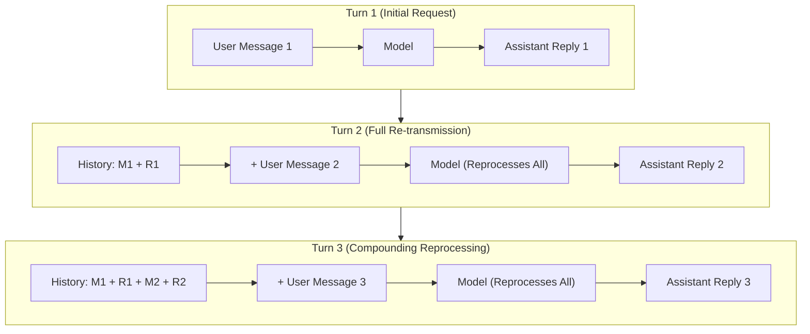
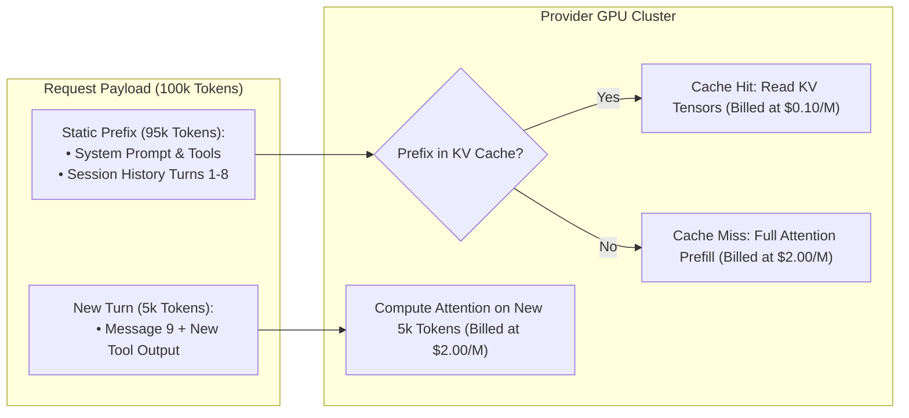

#AICoding #TokenEconomics #PromptCaching #ContextWindow #StatelessInference #CostOptimization #SystemDesign #OpenCode

> [!abstract] Executive Summary
> Unlike human conversationalists who retain persistent neural memories, Large Language Model inference is **fundamentally stateless**. Every interaction requires the agent harness to retransmit the **entire historical transcript**—system instructions, prior messages, reasoning traces, and all previous tool outputs—from token zero. Consequently, token consumption scales not linearly with the latest prompt, but **quadratically ($O(N^2)$)** across conversation turns. A session with 100,000 accumulated tokens consumes at least 1,000,000 input tokens across just 10 subsequent turns.
> 
> While modern **Prompt Caching** (KV-cache reuse) mitigates this financial tax—providing up to **90–95% discounts** on cached prefixes (e.g., Gemini 4 Argon at \$0.10/M cached vs. \$2.00–\$4.00/M uncached)—caching does not solve context window exhaustion or attention degradation. Production engineering architectures avoid pre-loading massive codebases into context, utilizing **Just-In-Time (JIT) On-Demand Tool Retrieval** to keep working memory lean.

---

## 1. The Mechanics of Stateless Reprocessing: The Compounding Token Trap

Because LLM API endpoints do not preserve internal memory states between HTTP requests, each request must retransmit the full context stack to re-hydrate the model's self-attention layers:

```
┌────────────────────────────────────────────────────────────────────────────────────────┐
│                        STATELESS REPROCESSING IN MULTI-TURN SESSIONS                   │
└────────────────────────────────────────────────────────────────────────────────────────┘

    Request 1:
    ┌───────────┐         ┌───────┐         ┌─────────┐
    │ Message 1 │────────>│ Model │────────>│ Reply 1 │
    └───────────┘         └───────┘         └─────────┘

    Request 2:
    ┌───────────┬─────────┬───────────┐         ┌───────┐         ┌─────────┐
    │ Message 1 │ Reply 1 │ Message 2 │────────>│ Model │────────>│ Reply 2 │
    └───────────┴─────────┴───────────┘         └───────┘         └─────────┘

    Request 3:
    ┌───────────┬─────────┬───────────┬─────────┬───────────┐         ┌───────┐         ┌─────────┐
    │ Message 1 │ Reply 1 │ Message 2 │ Reply 2 │ Message 3 │────────>│ Model │────────>│ Reply 3 │
    └───────────┴─────────┴───────────┴─────────┴───────────┘         └───────┘         └─────────┘
```



### The Quadratic Token Accumulation Equation:
If each conversation turn accumulates an average increment of $T_{\Delta}$ tokens (prompts, tool outputs, and reasoning steps), the cumulative input tokens processed by the API across $N$ turns is:

$$\text{Total Tokens Processed} = \sum_{k=1}^{N} (k \cdot T_{\Delta}) = T_{\Delta} \cdot \frac{N(N + 1)}{2} \approx \mathcal{O}(N^2)$$

```
┌────────────────────────────────────────────────────────────────────────────────────────┐
│                        THE COMPOUNDING ACCUMULATION CURVE                              │
└────────────────────────────────────────────────────────────────────────────────────────┘

    Turn Count    Context Size at Turn     Tokens Ingested On That Turn    Cumulative Ingest
    ────────────────────────────────────────────────────────────────────────────────────
    Turn 1         10,000 tokens            10,000 tokens                   10,000 tokens
    Turn 2         30,000 tokens            30,000 tokens                   40,000 tokens
    Turn 3         60,000 tokens            60,000 tokens                  100,000 tokens
    Turn 4         90,000 tokens            90,000 tokens                  190,000 tokens
    Turn 5        120,000 tokens           120,000 tokens                  310,000 tokens
    Turn 10       200,000 tokens           200,000 tokens                1,250,000 tokens!
```

Even if the user's latest prompt is only 5 words (*"Fix the typo"*), sending that message when the session holds 100,000 tokens bills the developer for **100,000 input tokens**.

---

## 2. The Invisible Token Iceberg

Developers frequently ask: *"My prompt was only 15 tokens. Why did my session burn 40,000 tokens?"*

In agentic engineering, the prompt typed into the terminal is only the visible tip of the token iceberg:

```
┌────────────────────────────────────────────────────────────────────────────────────────┐
│                             THE INVISIBLE TOKEN ICEBERG                                │
└────────────────────────────────────────────────────────────────────────────────────────┘

              ▲
             / \       Visible: User Prompt (15 tokens)
            /   \      "Fix the lexer line counting bug."
           /─────\
          /       \    System Prompts & Tool JSON Schemas (2,500 - 5,000 tokens)
         /         \   Tool schemas for read, edit, shell, grep, glob, webfetch.
        /───────────\
       /             \ Invisible Reasoning / Thinking Tokens (2,000 - 16,000 tokens)
      /               \ DeepSeek R1 / OpenAI o1 internal test-time search trees.
     /─────────────────\
    /                   \ Tool Outputs & File Dumps (15,000 - 80,000 tokens)
   /                     \ Entire files read via `read`, grep hit tables, test tracebacks.
  /───────────────────────\
```

### The 4 Major Invisible Token Sinks:
1. **Tool Output Ingestion:** When an agent calls `read("sloperator/lexer/scanner.py")`, the file's entire text (e.g., 800 lines $\approx$ 6,000 tokens) enters the context window and persists for all subsequent turns.
2. **Intermediate Reasoning Steps:** Reasoning models burn thousands of tokens testing hypothetical fixes before emitting their final code change.
3. **Verbose Terminal Dumps:** Running `pytest` or compiler checks with verbose flags (`-vv`) can dump thousands of lines of tracebacks into context.
4. **Harness Tool Schema Overhead:** Every tool exposed to the agent requires a complete JSON Schema description in the system prompt.

---

## 3. The Economics of Prompt Caching (KV-Cache Persistence)

To soften the quadratic cost curve of stateless reprocessing, frontier LLM providers (Google, Anthropic, OpenAI) implement **Prompt Caching**.

### How Prompt Caching Works:
1. When a client sends a request, the provider computes the **Key-Value (KV) Cache** tensors for each token in the Transformer's attention layers.
2. If the prefix of the prompt (system instructions + earlier conversation turns) matches a previously processed prefix within a designated Time-to-Live (TTL, typically 5 to 60 minutes), the provider **skips recomputing attention for that prefix**.
3. The provider reads the cached KV tensors directly from GPU VRAM or high-speed cache memory and bills the client at a heavily discounted rate.

```
┌────────────────────────────────────────────────────────────────────────────────────────┐
│                        PROMPT CACHING PRICE COMPARISON (2025/2026)                     │
└────────────────────────────────────────────────────────────────────────────────────────┘

    Provider / Model              Uncached Input / 1M Tokens    Cached Read / 1M Tokens    Discount
    ────────────────────────────────────────────────────────────────────────────────────────
    Gemini 4 Argon (Intro)        $2.00                         $0.10                      95% Off
    Gemini 4 Argon (Standard)     $4.00                         $0.10                      97.5% Off
    Claude 3.5 Sonnet             $3.00                         $0.30                      90% Off
    OpenAI GPT-4o                 $2.50                         $1.25                      50% Off
```



### The Limitations of Prompt Caching:
> [!WARNING] Caching is Not a Free Pass for Context Bloat
> 1. **Prefix Invalidation:** Caches match strictly from the beginning of the prompt. If a single token is modified early in the transcript (e.g., dynamically changing a system prompt timestamp), **the entire downstream cache is invalidated**.
> 2. **TTL Eviction:** If the developer pauses for 10 minutes between prompts, the provider evicts the KV cache from GPU memory, triggering a full-price uncached read on the next message.
> 3. **Context Window Saturation:** Cached tokens still consume physical slots in the model's context window. A cache hit saves money, but does **nothing** to prevent attention degradation ("Lost in the Middle").

---

## 4. Architectural Solution: On-Demand Retrieval vs. Pre-Loading

A legacy prompting anti-pattern is attempting to "prime" the model by feeding it the entire codebase, documentation library, and design specifications at session start:

```
┌────────────────────────────────────────────────────────────────────────────────────────┐
│                 PRE-LOADING (Anti-Pattern) vs. ON-DEMAND RETRIEVAL (JIT)               │
└────────────────────────────────────────────────────────────────────────────────────────┘

    [ Anti-Pattern: Context Pre-Loading ]
    Session Start:
    ├── Ingest `docs/` (40,000 tokens)
    ├── Ingest entire `sloperator/` package (60,000 tokens)
    └── Base Context: 100,000 tokens!
        └── Every subsequent interaction pays the 100k token penalty.
        └── Cache hits soften cost, but attention is severely degraded.

    [ Best Practice: Just-In-Time (JIT) On-Demand Retrieval ]
    Session Start:
    ├── Base Context: 1,500 tokens (System prompt + tool schemas only).
    └── As needed:
        ├── Agent reads ONLY `scanner.py` when fixing the lexer (+5,000 tokens).
        ├── Agent reads ONLY `test_lexer.py` to write regression test (+2,000 tokens).
        └── Peak Context: 8,500 tokens! (91% smaller, zero attention dilution).
```

### Key Rules for Context-Efficient Repository Design:
1. **Keep Reference Specs on Disk:** Store architecture notes, database schemas, and API documentation in markdown files within the repo (e.g. `docs/architecture.md`). Direct the agent to read them **only when relevant** via `@docs/architecture.md`.
2. **Prefer Grep/Glob over Bulk Reads:** Instruct the agent to locate specific symbol definitions with targeted grep queries before pulling an entire file into context memory.
3. **Isolate Deep Reconnaissance to Subagents:** Use `@explore` subagents to perform wide filesystem sweeps. The child session absorbs the tool output bloat, returning only a 200-token summary to the primary session.

---

## 5. Strategic Session Lifecycle Management

To avoid the exponential accumulation curve, senior engineers treat sessions as ephemeral, single-feature lifecycles:

```
┌────────────────────────────────────────────────────────────────────────────────────────┐
│                        SESSION LIFECYCLE DECISION MATRIX                               │
└────────────────────────────────────────────────────────────────────────────────────────┘

    Scenario                                    Action          Rationale
    ──────────────────────────────────────────────────────────────────────────────────────
    Iterating on a failing unit test            Keep Session    Leverages prompt cache hits;
    (Rapid back-and-forth debugging)                            fast turnaround, low latency.

    Completed test suite; moving to             Start Fresh     Breaks the O(N²) compounding curve;
    implement a new feature                     (/new)          clears stale file dumps and errors.

    Session context hits > 60% capacity         Compact or New  Eliminates attention dilution and
    (Telemetry turns yellow/red)                (/compact)      resets the prefill latency penalty.
```
