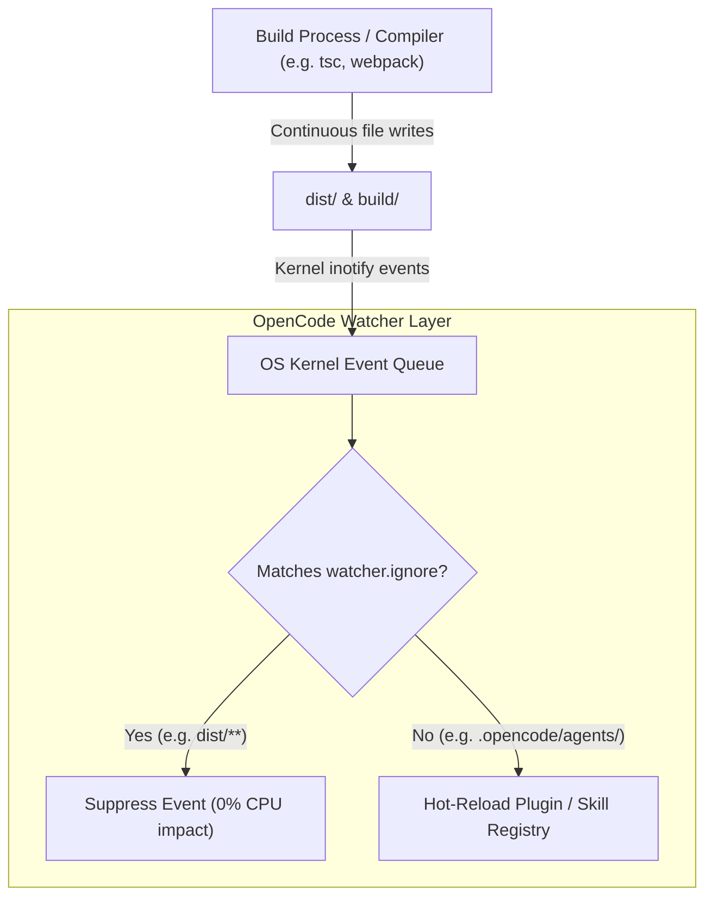

#AICoding #ContextHygiene #Ripgrep #Gitignore #Ignore #FileWatcher #Performance #SystemDesign #OpenCode

> [!abstract] Executive Summary
> Large Language Models lack innate spatial awareness of repository boundaries; when commanded to search for code, agent harnesses rely on **ripgrep (`rg`)** to scan the local filesystem. By default, ripgrep respects `.gitignore` rules, preventing massive build directories (`dist/`, `build/`) and package dependency trees (`node_modules/`, `.venv/`) from flooding the model's context window with irrelevant token noise.
> 
> However, version control tracking and search indexing are distinct concerns. Through the **`.ignore` file**, engineers decouple ripgrep search indexing from Git tracking—such as excluding massive lockfiles (`uv.lock`, `package-lock.json`) from search results while preserving them in Git, or force-including build outputs via negated globs (`!dist/`). Furthermore, for projects with heavy continuous build churn, the **`watcher.ignore` configuration** in `opencode.jsonc` suppresses operating system kernel filesystem events, preventing unnecessary hot-reload thrashing.

---

## 1. Search Mechanics in Agent Harnesses: The Ripgrep Foundation

When an AI agent calls `grep` or `glob`, it does not execute a naive recursive Python file walk. Modern agent harnesses (like OpenCode) execute compiled **ripgrep (`rg`)** subprocesses or bindings.

Ripgrep is designed with built-in awareness of developer environments:
1. It automatically ignores hidden files (starting with `.`).
2. It automatically respects `.gitignore` rules across nested directory trees.
3. It detects and ignores binary files.

```
┌────────────────────────────────────────────────────────────────────────────────────────┐
│                        HOW RIPGREP FILTERS AGENT CONTEXT INGESTION                     │
└────────────────────────────────────────────────────────────────────────────────────────┘

    User Prompt: "Find where LexicalError is defined"
          │
          ▼
    Agent Tool Call: grep("LexicalError")
          │
          ▼
    Ripgrep Execution Engine
    ├── Reads `.gitignore`    ──> Excludes: node_modules/, dist/, .venv/, logs/
    ├── Reads `.ignore`       ──> Excludes: uv.lock, fixtures/large_dump.json
    └── Executes Rust Search  ──> Returns only 2 relevant source files!
          │
          ▼
    Context Window Ingestion: ~300 tokens (Clean, surgical, low cost)
```

Without ignore filters, a simple keyword search matching inside a compiled JavaScript bundle in `dist/` or a Python virtualenv in `.venv/` would dump **50,000 to 200,000 tokens** of unreadable minified code into the context window, causing instant context bloat and high billing spikes.

---

## 2. Decoupling Search from Version Control: `.gitignore` vs. `.ignore`

A frequent engineering dilemma occurs when a file **must be tracked by Git**, but **should never be searched by an AI agent**:

```
┌────────────────────────────────────────────────────────────────────────────────────────┐
│                        THE `.gitignore` vs. `.ignore` MATRIX                           │
└────────────────────────────────────────────────────────────────────────────────────────┘

    File / Directory            Git Status           Ripgrep / OpenCode Status    Configuration File
    ──────────────────────────────────────────────────────────────────────────────────────────────────
    logs/runs.log               Untracked (Ignore)   Excluded from search         .gitignore
    node_modules/               Untracked (Ignore)   Excluded from search         .gitignore
    uv.lock / package-lock.json Tracked by Git       Excluded from search         .ignore
    fixtures/big_payload.json   Tracked by Git       Excluded from search         .ignore
    dist/bundle.js (for debug)  Untracked (Ignore)   Included in search           .ignore (!dist/)
```

### The Lockfile Case Study (`uv.lock`):
Dependency lockfiles (like `uv.lock`, `poetry.lock`, or `package-lock.json`) are essential for deterministic reproducible builds. They **must be committed to Git**.

However, a lockfile can span 10,000 to 50,000 lines of serialized hashes and package metadata. If an agent executes a search for a library name (e.g., `pytest`), ripgrep hits hundreds of matches inside `uv.lock`. If the agent reads these results into context, it burns thousands of tokens without gaining actionable source code.

### The Solution:
1. Leave `uv.lock` out of `.gitignore` so Git continues tracking it.
2. Add `uv.lock` to `.ignore` in the project root so ripgrep skips it during search sweeps.

```
# Project Root Configuration

# .gitignore
logs/
dist/
.venv/
__pycache__/

# .ignore (Ripgrep overrides)
uv.lock
fixtures/mock_data.json
!dist/               # Force ripgrep to search dist/ even though it is in .gitignore
```

---

## 3. Hands-On Verification: Testing Ignore Policies via Git CLI

Engineers verify that files are correctly excluded from search while remaining tracked by Git using standard command-line flags:

```bash
# 1. Verify that logs/ is ignored by Git (.gitignore)
git check-ignore --no-index logs/runs.log
# Expected exit code: 0 (Ignored by Git)

# 2. Verify that uv.lock is ignored by ripgrep (.ignore)
git -c core.excludesFile=.ignore check-ignore --no-index uv.lock
# Expected exit code: 0 (Ignored by search ignore rules)

# 3. Verify that uv.lock is NOT ignored by Git (Git still tracks it!)
git check-ignore --no-index uv.lock
# Expected exit code: 1 (Not ignored by .gitignore; safe to commit)
```

```bash
# Submit verified solution via Bootdev CLI
bootdev run 6e9ed474-ee1e-4c7c-9109-073a5d0c4d90
bootdev run -s 6e9ed474-ee1e-4c7c-9109-073a5d0c4d90
```

---

## 4. File Watcher Event Suppression: `watcher.ignore` in `opencode.jsonc`

OpenCode runs an active file watcher daemon (`fs.watch` / kernel `inotify` / `ReadDirectoryChangesW`) to enable hot-reloading of custom skills, agents, and plugins when files are saved.

### The Watcher Thrashing Problem:
During active development, automated build tools, linters, and compilers (such as `tsc --watch`, `webpack`, or test runners generating coverage dumps) continuously write temporary files to disk. Each file write triggers an OS kernel event, forcing the agent harness to evaluate whether internal plugins or skills require recompilation.

In high-churn repositories, this causes **watcher event thrashing**, spiking daemon CPU usage and causing race conditions.



### Declarative Configuration in `opencode.jsonc`:
To suppress noisy filesystem events without preventing the agent from reading or searching those files on demand, configure `watcher.ignore`:

```jsonc
{
  "$schema": "https://opencode.ai/config.json",
  "watcher": {
    "ignore": [
      "node_modules/**",
      "dist/**",
      ".git/**",
      "coverage/**",
      ".pytest_cache/**"
    ]
  }
}
```

> [!NOTE] Search vs. Watcher Distinction
> Configuring `"dist/**"` in `watcher.ignore` does **not** stop the agent from reading or searching files inside `dist/`. It only prevents file writes inside `dist/` from emitting live daemon notification events.

---

## 5. Architectural Synthesis: The 3-Tier Filter Architecture

```
┌────────────────────────────────────────────────────────────────────────────────────────┐
│                     THE 3-TIER CONTEXT FILTERING ARCHITECTURE                          │
└────────────────────────────────────────────────────────────────────────────────────────┘

    Layer 1: Version Control Layer (.gitignore)
    • Purpose: Controls what Git commits and tracks in remote repositories.
    • Managed by: Git CLI & Git hooks.
    • Examples: .venv/, logs/, dist/, .env

    Layer 2: Search Indexing Layer (.ignore)
    • Purpose: Controls what Ripgrep and OpenCode tools inspect during grep/glob.
    • Managed by: Ripgrep engine.
    • Examples: uv.lock, package-lock.json, fixtures/huge_payload.json

    Layer 3: Harness Event Layer (watcher.ignore in opencode.jsonc)
    • Purpose: Controls what filesystem events wake up the agent daemon.
    • Managed by: OpenCode filesystem watcher.
    • Examples: node_modules/**, dist/**, .git/**
```
