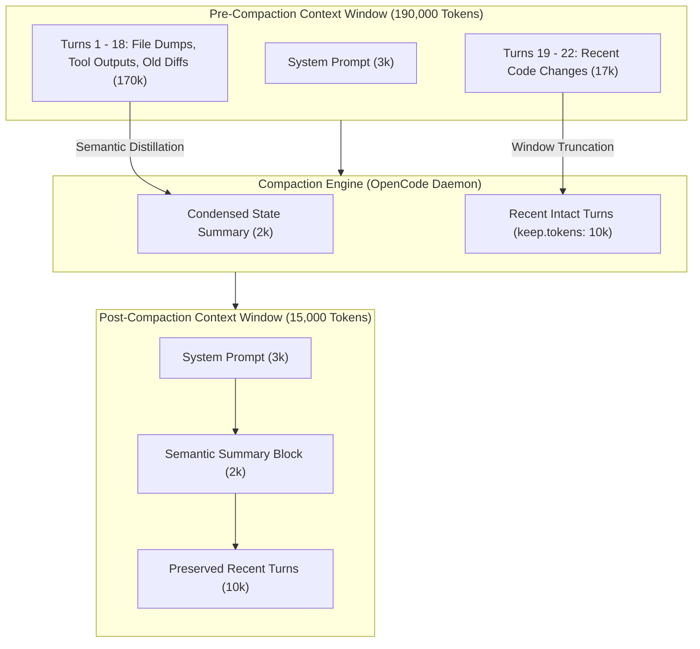

#AICoding #ContextCompaction #ContextWindow #TokenEconomics #SystemDesign #OpenCode #MemoryManagement #Resilience

> [!abstract] Executive Summary
> When interacting directly with raw LLM provider APIs, exceeding the context window results in an unrecoverable **hard stop** (`HTTP 400: context_length_exceeded`). Autonomous agent harnesses eliminate this catastrophic failure mode through **Automated Session Compaction**: dynamically summarizing conversational history and pruning context before the hard boundary is breached.
> 
> Unlike lossless algorithmic compression (e.g., gzip), compaction is **fundamentally lossy**: it performs semantic distillation, discarding ephemeral tool dumps and intermediate errors while crystallizing critical architectural decisions, modified file paths, and active goals. OpenCode implements a **Hybrid Compaction Architecture** that marries a structured high-level summary with a sliding window of recent intact turns (`keep.tokens`), guarded by an anticipatory safety margin (`buffer`). Furthermore, developers can manually trigger guided compaction via `/compact` at logical Git commit boundaries, enabling robust, long-running persistent sessions.

---

## 1. The Context Wall: Raw API Hard Stops vs. Harness Resilience

When communicating with raw LLM inference endpoints (OpenAI, Anthropic, DeepSeek, Google), the context window is a non-negotiable hardware/model boundary:

```
┌────────────────────────────────────────────────────────────────────────────────────────┐
│                        RAW API HARD STOP vs. HARNESS AUTO-COMPACTION                   │
└────────────────────────────────────────────────────────────────────────────────────────┘

    [ Raw API Interaction (No Harness) ]
    Turn 14: Context hits 200,001 / 200,000 tokens
          │
          ▼
    💥 HTTP 400 Bad Request: "This model's maximum context length is 200,000 tokens.
       However, you requested 200,001 tokens. Please reduce the length of the messages."
       └── Session aborted unrecoverably. All conversational state is lost!

    [ OpenCode Resilient Harness ]
    Turn 14: Context approaches threshold (Context >= Limit - buffer)
          │
          ▼
    🛡️ Auto-Compactor triggers in background:
       1. Persists full raw transcript to disk (`logs/transcript.jsonl`).
       2. Synthesizes lossy semantic summary of historical progress.
       3. Preserves the last 10,000 tokens of raw recent turns (`keep.tokens`).
       4. Swaps active context window with the compacted payload.
       └── Context drops from 180,000 to 14,000 tokens (92% reduction).
       └── Session continues seamlessly without interruption!
```

---

## 2. The Mechanics of Semantic Compaction: Lossless vs. Lossy

Computer science distinguishes between two fundamental compression paradigms:
- **Lossless Compression (e.g., zlib, brotli):** $f^{-1}(f(x)) = x$. Every exact bit can be mathematically reconstructed. It cannot reduce natural language tokens by 90% without losing information.
- **Lossy Semantic Distillation:** Information is selectively discarded. Ephemeral details (raw tool traces, temporary variable names, failing test logs) are purged; only semantic invariants and goals survive.

```
┌────────────────────────────────────────────────────────────────────────────────────────┐
│                        WHAT SURVIVES CONTEXT COMPACTION                                │
└────────────────────────────────────────────────────────────────────────────────────────┘

    DISCARDED DURING COMPACTION (The Noise)        PRESERVED IN COMPACTION (The Signal)
    ───────────────────────────────────────        ────────────────────────────────────
    • 45 failed grep tool execution outputs.       • Exact files modified and inspected.
    • 2,000 lines of pytest traceback logs.        • High-level objective and requirements.
    • Intermediate conversational banter.          • Invariants, architecture rules, decisions.
    • Outdated diff drafts that were rewritten.    • Suggested next steps and pending tasks.
```

### The 4 Artifacts of a Compaction Summary:
1. **Relevant File Manifest:** Which files were examined or altered, and what specific logic resides in them.
2. **Goal & Progress Tracker:** What feature or bug was requested, what approaches were attempted, and what has been successfully verified.
3. **Persisted Constraints:** Non-negotiable architectural mandates (e.g., *"Do not import third-party packages; preserve Python 3.10 compatibility"*).
4. **Active State & Next Steps:** Immediate blocking items that the agent was preparing to tackle next.

> [!NOTE] Disk Persistence vs. Active Memory
> Compaction alters **only the active in-memory context window** passed to the model. The complete, unedited historical transcript remains safely stored on disk in `.system_generated/logs/transcript.jsonl`. No engineering history is permanently erased.

---

## 3. The Hybrid Compaction Model: Summary + Sliding Window

A purely summarized context suffers from a major defect: it loses the precise syntactic rhythm and exact line references of the most recent code changes. Conversely, a pure sliding window (FIFO queue) loses the original system instructions and overarching project goals.

OpenCode solves this by deploying a **Hybrid Compaction Model**:



$$\text{Active Context}_{\text{post-compact}} = \text{System Prompt} + \text{Distilled State Summary} + \text{Recent Turns}_{\le \texttt{keep.tokens}}$$

---

## 4. Safety Headroom Buffers: Why `buffer` is Essential

In high-concurrency agent workflows, token consumption is not smooth or incremental. A single tool call—such as reading a generated schema or dumping terminal output—can suddenly inject **15,000 to 30,000 tokens** into the context in a single step.

If an agent waits until context usage hits 99% before compacting, a sudden tool output spike will push it past 100%, triggering an unrecoverable provider hard stop.

```
┌────────────────────────────────────────────────────────────────────────────────────────┐
│                        THE ROLE OF THE SAFETY BUFFER (Headroom)                        │
└────────────────────────────────────────────────────────────────────────────────────────┘

    0 Tokens                                        180,000 Tokens       200,000 Tokens
    ├──────────────────────────────────────────────────────┼──────────────────┤
    │                  Safe Operating Zone                 │  Safety Buffer   │ Hard Model Limit
    │                  (Normal Execution)                  │  (20,000 Tokens) │ (Crash Zone)
    └──────────────────────────────────────────────────────┴──────────────────┘
                                                           ▲
                                                           │
                                        Compaction Triggers HERE!
                                        (Context >= Model Limit - Buffer)
```

The trigger condition is mathematically defined as:

$$\text{Trigger Compaction When: } \quad \text{Current Tokens} \ge (\text{Model Max Tokens} - \texttt{buffer})$$

Increasing `buffer` forces OpenCode to compact earlier, providing a wider cushion against unpredictable reasoning spikes and voluminous tool outputs.

---

## 5. Declarative Configuration in `opencode.jsonc`

Compaction behavior is governed declaratively in the root `opencode.jsonc` file:

```jsonc
{
  "$schema": "https://opencode.ai/config.json",
  "compaction": {
    // Enable or disable automatic compaction near context limits
    "auto": true,
    
    // Approximate token allowance of raw recent context to keep intact alongside summary
    "keep": {
      "tokens": 10000
    },
    
    // Safety buffer below the model's hard maximum to trigger compaction early
    "buffer": 20000
  }
}
```

### Configuration Options Reference:
| Property | Type | Default | Operational Impact |
| :--- | :--- | :--- | :--- |
| **`auto`** | `boolean` | `true` | When `true`, OpenCode monitors context telemetry and compacts automatically. Should remain enabled in virtually all projects. |
| **`keep.tokens`** | `integer` | `10000` | Higher values preserve more recent conversational nuance; lower values yield smaller, faster contexts post-compaction. |
| **`buffer`** | `integer` | `20000` | Higher values provide safety against sudden large file reads; lower values maximize utilization of the raw window. |

---

## 6. Operational Workflows: Manual Guided Compaction (`/compact`)

While automatic compaction acts as a resilient safety net, senior software engineers actively trigger **Manual Compaction** using the `/compact` command.

### The Guided Compaction Pattern:
When triggering `/compact`, developers can supply custom natural language guidance to focus the distillation:

```bash
# Example 1: General compaction at a feature milestone
/compact

# Example 2: Guided compaction discarding failed experiments
/compact Discard the failed attempts at using regex in scanner.py; preserve only the final state-machine refactor and test commands.

# Example 3: Schema-focused compaction
/compact Drop all terminal logs; summarize only the new database migration tables and foreign key constraints.
```

### The "Git Commit Boundary" Workflow:
Rather than abandoning a session and creating a new one (`/new`) after every minor task, developers adopt the **Commit-and-Compact Pattern**:

```
┌────────────────────────────────────────────────────────────────────────────────────────┐
│                        THE COMMIT-AND-COMPACT WORKFLOW                                 │
└────────────────────────────────────────────────────────────────────────────────────────┘

    [ Step 1: Implement Feature ]
    • Agent edits code, runs pytest, iterates back-and-forth.
    • Context climbs to 85,000 tokens.
    
    [ Step 2: Milestone Verification & Git Commit ]
    • Tests pass cleanly.
    • Developer reviews diff and executes git commit.
    
    [ Step 3: Manual Guided Compaction ]
    • Developer types: `/compact We have committed the lexer line-counting fix. Continue to the parser.`
    • Context resets to 12,000 tokens with full awareness of the committed architecture!
    
    [ Step 4: Continue Next Feature ]
    • Session continues without losing project identity, style guidelines, or established patterns.
```

---

## 7. Strategic Lifecycle Matrix

| Strategy | When to Use | Advantages | Trade-offs |
| :--- | :--- | :--- | :--- |
| **Auto-Compaction** | Background safety net during all deep agentic coding sessions. | Prevents unrecoverable `HTTP 400` context crashes automatically. | Lossy summary may occasionally drop subtle nuances if not guided. |
| **Manual `/compact`** | At logical Git commit milestones or after noisy multi-turn debugging sessions. | Developer steers what gets remembered; resets latency and per-turn billing. | Requires proactive developer action. |
| **Fresh Session (`/new`)** | When switching to an entirely unrelated repository area or architectural domain. | Complete reset to token zero; eliminates any risk of historical context bleed. | Loses recent conversational rapport and immediate file context. |
