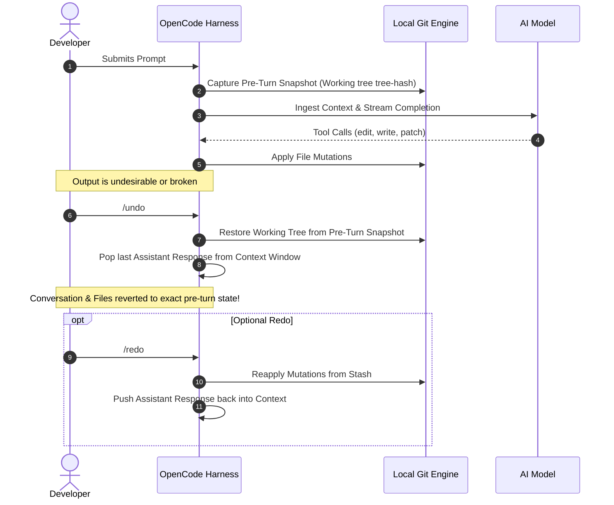

#AICoding #ContextManagement #UndoRedo #SessionForking #GitWorktree #Rollback #SystemDesign #OpenCode

> [!abstract] Executive Summary
> In sophisticated agentic engineering, conversational context is not an append-only linear log; it is a **mutable, version-controlled resource graph**. When an agent produces a hallucinated refactor or fails a task due to an ambiguous prompt, attempting to "talk the model back on track" over multiple turns pollutes the context window with negative examples, failed diffs, and confusing apologies—inducing compounding cognitive degradation.
> 
> OpenCode solves this through non-destructive context manipulation primitives: **`/undo` and `/redo`**, which roll back both the conversation transcript and the corresponding filesystem working tree via **Git-backed atomic snapshots**. To test divergent or risky architectural hypotheses without trashing established context, developers leverage **`/fork`** to branch session history from any arbitrary historical message. However, because forked sessions share the identical underlying filesystem by default, production workflows pair `/fork` with **Git Worktrees** to achieve true dual-layer isolation across both context memory and disk state.

---

## 1. The Context-as-a-Resource Paradigm

Junior developers treat an AI coding session as an immutable chat log. When the model generates a broken implementation, they engage in a multi-turn argument:

```
┌────────────────────────────────────────────────────────────────────────────────────────┐
│                        THE "CORRECTION SPIRAL" ANTI-PATTERN                            │
└────────────────────────────────────────────────────────────────────────────────────────┘

    Turn 1 (Vague Prompt): "Refactor auth logic" ──────────> Model writes broken JWT code
    Turn 2: "No, that broke the tests, revert it" ─────────> Model half-reverts, leaves syntax error
    Turn 3: "Now it doesn't even compile! Fix it" ─────────> Model writes complex hack
    Turn 4: "Forget that, go back to where we started" ────> Model hallucinates previous state
    
    💥 Result: 4 turns of failure states, toxic diffs, and conflicting instructions
       permanently baked into context. Every subsequent token pays for this noise!
```

### The Senior Engineer's Alternative: The Clean Rollback
Rather than steering a derailed agent through conversational argumentation, the optimal engineering move is instantaneous: **`/undo` and re-prompt**.

```
┌────────────────────────────────────────────────────────────────────────────────────────┐
│                        THE CLEAN ROLLBACK PATTERN (/undo)                              │
└────────────────────────────────────────────────────────────────────────────────────────┘

    Turn 1 (Vague Prompt): "Refactor auth logic" ──────────> Model writes broken JWT code
          │
          ▼
    Developer executes: `/undo`
    ├── Transcript pruned: Turn 1 is erased from context window memory.
    └── Filesystem restored: Git snapshot reverts touched files to pre-turn state.
          │
          ▼
    Turn 1 (Refined Prompt): "Refactor auth logic in src/auth.py using HMAC-SHA256 only"
    └── Model executes cleanly on pristine context with zero historical pollution!
```

---

## 2. Mechanics of `/undo` & `/redo`: Git-Backed Snapshots

OpenCode integrates filesystem state tracking directly with conversation turn boundaries:



### The Commit Boundary Rule:
- After executing `/undo`, you can freely run `/redo` to restore the undone state.
- **The Invalidation Threshold:** Submitting any new prompt after `/undo` **permanently prunes the undone turn**. The redo branch is discarded, establishing the new prompt as the canonical branch head.

---

## 3. The Boundaries of Snapshot Restoration

While `/undo` restores tracked repository files, developers must understand its operational limits. The harness operates on a **best-effort Git snapshot model**:

```
┌────────────────────────────────────────────────────────────────────────────────────────┐
│                        WHAT `/undo` CAN AND CANNOT REVERSE                             │
└────────────────────────────────────────────────────────────────────────────────────────┘

    SAFE TO ROLL BACK VIA `/undo`                 CANNOT BE REVERSED BY `/undo`
    ─────────────────────────────                 ─────────────────────────────
    ✔ Modifications to tracked Git files.        ✖ Database schema migrations & row writes.
    ✔ New files created inside the repo root.     ✖ Files created outside repo root (/tmp, ~/).
    ✔ Local file deletions inside the repo.       ✖ Network side-effects (Stripe/AWS API calls).
    ✔ In-memory context window tokens.            ✖ Background OS processes spawned by shell.
```

> [!WARNING] The Shell Command Blindspot
> If an agent executes `shell("psql -c 'DROP TABLE users;'")` or `shell("npm install -g malicious-pkg")`, running `/undo` will remove the shell tool output from context, but **it will not reconstruct your database tables or uninstall the global binary**. Real backups, disposable sandbox containers, and strict tool permissions (`effect: "ask"` on shell) remain non-negotiable.

---

## 4. Session Forking (`/fork`): Exploring Divergent Hypotheses

When tackling complex architectural refactors, engineers often face multiple viable design choices:
- *Option A:* Refactor the state machine using an enum-driven dispatch loop.
- *Option B:* Refactor the state machine using the Gang-of-Four State Pattern with polymorphic classes.

Attempting to evaluate both within a single linear session creates conflicting architectural instructions that confuse the model.

### The `/fork` Workflow:
The `/fork` command clones the current session's context up to a selected **fork point** in the message history, launching an independent child session:

```
┌────────────────────────────────────────────────────────────────────────────────────────┐
│                        SESSION CONTEXT FORKING TOPOLOGY                                │
└────────────────────────────────────────────────────────────────────────────────────────┘

    [ Main Session (Master Context) ]
    ├── Message 1: "Set up compiler pipeline"
    ├── Message 2: "Implement Lexer and Token stream"
    ├── Message 3: "Add scanner error handling"  <── [ FORK POINT SELECTED ]
    │                                                   │
    │ (Continues standard development)                  │  (Spawns new child session)
    ├── Message 4: "Implement Parser"                   ▼
    └── Message 5: "Implement Code Gen"         [ Forked Session: "experiment-state-pattern" ]
                                                ├── Message 1: "Set up compiler pipeline"
                                                ├── Message 2: "Implement Lexer and Token stream"
                                                ├── Message 3: "Add scanner error handling"
                                                └── Message 4: "Try polymorphic state pattern"
```

### Strategic Benefits of Forking:
1. **Zero Context Re-Creation:** You do not need to re-explain the project architecture, style guidelines, or established decisions to a brand new session.
2. **Context Quarantine:** Risky experiments, massive debugging traces, or discarded prototypes stay isolated in the fork without polluting the main session.
3. **Safe Reversion:** If the experimental approach fails, you simply close the forked session and return to the main session.

---

## 5. The Shared Filesystem Dilemma: Pairing `/fork` with Git Worktrees

There is a critical trap that surprises many developers when using `/fork`:

> [!CAUTION] The Shared Disk Trap
> **`/fork` isolates conversational context, but it does NOT isolate the filesystem.**
> Both the original session and the forked session operate on the exact same directory on your hard drive. If the forked session mutates files in `src/`, switching back to the original session leaves those modified files sitting in your working tree!

```
┌────────────────────────────────────────────────────────────────────────────────────────┐
│                        THE SHARED FILESYSTEM TRAP vs. WORKTREE ISOLATION               │
└────────────────────────────────────────────────────────────────────────────────────────┘

    [ Standard Fork (Shared Disk Hazard) ]
    Main Session Context ────────┐
                                 ├──> Shares C:\projects\sloperator\src\ (COLLISION RISK!)
    Forked Session Context ──────┘

    [ Production Pattern: Fork + Git Worktree (Complete Dual-Layer Isolation) ]
    Main Session Context ────────────> C:\projects\sloperator\ (main branch)
    Forked Session Context ──────────> C:\projects\sloperator-experiment\ (worktree branch)
```

### The Dual-Layer Isolation Workflow:
To achieve total isolation across both context and disk, pair `/fork` with a **Git Worktree**:

```bash
# Step 1: Create a lightweight Git worktree linked to a separate experiment branch
git worktree add ../sloperator-polymorphic-experiment -b experiment/state-pattern

# Step 2: In OpenCode, fork the current session
/fork

# Step 3: Command the forked agent to target the isolated worktree
"We are working in ../sloperator-polymorphic-experiment. Apply your changes exclusively there."
```

When finished:
- If the experiment **succeeds**: Merge `experiment/state-pattern` into `main` and remove the worktree (`git worktree remove ../sloperator-polymorphic-experiment`).
- If the experiment **fails**: Simply delete the worktree and discard the forked session. The primary codebase and the primary session context remain 100% untouched.

---

## 6. Context Control Decision Matrix

| Tactical Need | Recommended Command | Operational Scope | Reversibility |
| :--- | :--- | :--- | :--- |
| **Output failed due to a flawed prompt** | **`/undo`** | Reverts last assistant turn and restores Git working tree snapshot. | Reversible via `/redo` until a new prompt is sent. |
| **Restore a mistakenly undone turn** | **`/redo`** | Reapplies the undone turn and re-executes file mutations. | Instantaneous; lost if a new message is submitted. |
| **Test a divergent architectural hypothesis** | **`/fork`** | Clones historical context up to a selected fork point into a new session. | Permanent independent session; leaves main session context clean. |
| **Risky refactor with heavy disk writes** | **`/fork` + Git Worktree** | Forks context *and* binds the child session to an isolated physical worktree directory. | 100% safe; eliminates disk collision risks. |
| **Session context > 70% capacity** | **`/compact`** | Lossy semantic distillation; drops token count while retaining key decisions. | Irreversible context truncation; full transcript preserved on disk. |
