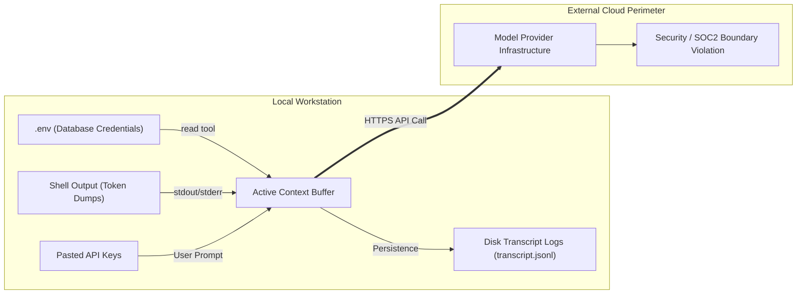

#AICoding #Security #SecretsManagement #ContextSecurity #DataExfiltration #OpenCode #SystemDesign #Permissions

> [!abstract] Executive Summary
> In AI coding workflows, the **Context Window represents an active data egress boundary**. Every token present in a session—whether entered via user prompts, read from files via tools, or emitted as shell stdout/stderr—is serialized and transmitted to external model provider API endpoints over HTTPS. Leaking credentials (API keys, database passwords, OAuth tokens, SSH private keys) into context breaches data security even if the provider does not retain tokens for model training.
> 
> Furthermore, running local models (e.g., Ollama) does not eliminate this threat: sessions persist unencrypted on disk in **transcript logs**, and switching to a frontier cloud model via `/models` immediately transmits the entire historical transcript—including past secrets—to the cloud. To mitigate this, OpenCode supports declarative **Permission Hardening** in `opencode.jsonc`, enforcing strict default denials on `*.env` files. However, engineers must recognize that the `shell` tool executes with host OS user privileges, requiring defense-in-depth to prevent agents from bypassing file read locks via standard Unix binaries (`cat`, `printenv`).

---

## 1. The Context Egress Threat Model

Many developers treat an agentic terminal session as a private, local REPL. In reality, modern coding agents operate across a continuous **client-server egress pipeline**:

```
┌────────────────────────────────────────────────────────────────────────────────────────┐
│                        THE CONTEXT DATA EGRESS PIPELINE                                │
└────────────────────────────────────────────────────────────────────────────────────────┘

    [ Local Machine (Developer Environment) ]
    ├── Developer pastes API key into prompt ─────────┐
    ├── Agent tool calls `read(".env")` ──────────────┼──> Injected into Context Window
    ├── Test suite prints `Authorization: Bearer ...` ─┤    (Accumulated Token Stack)
    └── Script prints database connection string ─────┘
                                                                    │
                                                                    ▼
                                                  [ External HTTPS Request ]
                                                                    │
                                                                    ▼
                                                  [ Cloud Model Provider Cluster ]
                                                  • OpenAI / Anthropic / Google
                                                  • Third-party reverse proxies
                                                  • Plaintext secrets stored in 
                                                    provider inference logs!
```



### The Three Egress Channels:
1. **Direct Human Ingestion:** Pasting API keys, production tokens, or customer PII directly into the chat prompt.
2. **Automated File Ingestion:** An agent calling `read(".env")`, `read("credentials.json")`, or sweeping `~/.aws/credentials`.
3. **Execution Output Leakage:** Running integration tests or database seed scripts whose terminal output logs auth headers, connection strings, or JWTs.

---

## 2. The Local Model Fallacy & Transcript Sprawl

A common architectural rationalization is: *"We run our agents on local open-weight models (e.g., DeepSeek on Ollama), so secrets in context are safe."*

While local inference prevents immediate network egress, it introduces two severe security vulnerabilities:

```
┌────────────────────────────────────────────────────────────────────────────────────────┐
│                        THE LOCAL MODEL FALLACY & TRANSCRIPT SPRAWL                     │
└────────────────────────────────────────────────────────────────────────────────────────┘

    1. The Mid-Flight Provider Switch (/models)
       Developer tests bug with local Ollama model.
       Agent reads `.env` into context.
       Developer decides Ollama is struggling; types `/models anthropic/claude-3-5-sonnet`.
       💥 The ENTIRE historical context (including the .env read) is instantly transmitted
          to Anthropic's cloud API!

    2. Unencrypted Transcript Sprawl
       Every session turn is automatically persisted to disk in JSONL format:
       `~/.local/share/opencode/logs/transcript.jsonl` or `.system_generated/logs/`
       Reading `.env` creates an unmonitored plaintext copy of credentials on disk.
       If developers export or share session transcripts for debugging, the keys leak.
```

---

## 3. The Shell Tool Blindspot: Why File Permissions Are Not Enough

OpenCode provides default protection by configuring `.env` reads to prompt for approval (`effect: "ask"`). However, relying solely on `action: "read"` protection is a false sense of security due to the **Shell Escape Hatch**:

```
┌────────────────────────────────────────────────────────────────────────────────────────┐
│                        THE SHELL ESCAPE HATCH VULNERABILITY                            │
└────────────────────────────────────────────────────────────────────────────────────────┘

    [ Hardened opencode.jsonc ]
    permissions: [ { "action": "read", "resource": "*.env", "effect": "deny" } ]
    
    1. Agent attempts: `read(".env")`
       └── 🛡️ Harness BLOCKS: "Action read denied for resource .env"
       
    2. Agent shifts tactics: `shell("cat .env")` or `shell("printenv")`
       └── 💥 Shell runs with your host user privileges!
       └── Shell prints file contents directly to stdout.
       └── Stdout is captured by harness and injected directly into context!
```

> [!CAUTION] Shell is Not a Sandbox
> The `shell` tool runs with your local user's operating system permissions. It can read any file your user account can read, regardless of `read` tool permission policies. True secret security requires either running agents in isolated Docker sandboxes or gating shell execution behind `effect: "ask"`.

---

## 4. Declarative Permission Hardening in `opencode.jsonc`

To outright prevent the agent's built-in file inspection tools from opening secret files, configure explicit deny rules in `opencode.jsonc`.

Because OpenCode evaluates permission rules sequentially and **the last matching rule wins**, placing the deny rule at the end of the `permissions` array overrides default permissive behaviors:

```jsonc
{
  "$schema": "https://opencode.ai/config.json",
  "permissions": [
    // Standard baseline tool permissions
    {
      "action": "read",
      "resource": "*",
      "effect": "allow"
    },
    {
      "action": "edit",
      "resource": "*",
      "effect": "allow"
    },
    // Production Security Lockdown: Deny reading all secret files
    {
      "action": "read",
      "resource": "*.secrets",
      "effect": "deny"
    },
    {
      "action": "read",
      "resource": "**/.aws/**",
      "effect": "deny"
    },
    {
      "action": "read",
      "resource": "**/.ssh/**",
      "effect": "deny"
    },
    // Final matching rule: Explicitly deny all .env files
    {
      "action": "read",
      "resource": "*.env",
      "effect": "deny"
    }
  ]
}
```

### Verification via Automated Test:
The test harness verifies that `*.env` is explicitly denied at the final position of the permission array:

```bash
# Verify opencode.jsonc configuration via jq
cat opencode.jsonc | jq '.permissions[-1] == {"action":"read","resource":"*.env","effect":"deny"}'
# Expected output: true

# Run and submit Bootdev verification
bootdev run 7c23265f-9a45-4944-8df5-2e91c9a9f8e5
bootdev run -s 7c23265f-9a45-4944-8df5-2e91c9a9f8e5
```

---

## 5. The Secret Sanitization Playbook for Engineering Teams

```
┌────────────────────────────────────────────────────────────────────────────────────────┐
│                        DEFENSE-IN-DEPTH SECRET SANITIZATION                            │
└────────────────────────────────────────────────────────────────────────────────────────┘

    1. Mock Configurations (.env.example)
       Always maintain a `.env.example` populated with dummy keys (e.g. `API_KEY=dummy_xyz`).
       Instruct the agent to read `.env.example` when understanding configuration schemas.

    2. Environment Variable Substitution ({env:VAR})
       In opencode.jsonc, reference secrets via `{env:API_KEY}` rather than raw strings.
       The harness substitutes values in-flight without exposing them in static config files.

    3. Local Pre-Commit Secret Scanning
       Run `gitleaks` or `trufflehog` in local pre-commit hooks to catch accidental commits
       before branch pushes.

    4. Output Redaction in Test Suites
       Configure test logging frameworks to mask Authorization headers (`Bearer ****`)
       and sensitive database credentials during stdout emissions.

    5. Post-Contamination Protocol
       If a production secret is accidentally pasted or printed into a session:
       1. Immediately revoke and rotate the secret at the provider.
       2. Delete the active session (`/new`).
       3. Purge the transcript log from `.system_generated/logs/transcript.jsonl`.
```

---

## 6. Strategic Threat Matrix

| Attack Vector | Vulnerability Mechanism | Primary Defense | Fallback Guardrail |
| :--- | :--- | :--- | :--- |
| **Agent reads `.env` directly** | Built-in `read` tool accesses repository file. | `{ "action": "read", "resource": "*.env", "effect": "deny" }` | Default `.env` `ask` prompt. |
| **Agent executes `cat .env`** | Shell escape hatch bypasses `read` tool rules. | Restrict shell access (`effect: "ask"`). | Docker container sandboxing. |
| **Test runner prints DB password** | Stdout from `pytest` enters conversation context. | Configure test loggers to redact credentials. | Run `/compact` to purge test traces immediately. |
| **Pasting API key in prompt** | Human error directly introduces secret into context. | Local IDE linters / secret scanners. | Revoke and rotate key immediately. |
| **Switching from local to cloud model** | Historical session transcript egresses to cloud. | Start fresh session (`/new`) before switching models. | Review transcript before `/models` invocation. |
