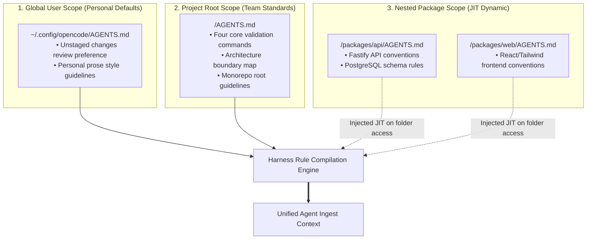

#AICoding #AgentRules #AGENTSmd #Monorepo #ContextManagement #OpenCode #SystemDesign #SoftwareEngineering

> [!abstract] Executive Summary
> Retyping project conventions, testing instructions, and coding guidelines at the start of every AI session is a major productivity tax. Modern autonomous coding harnesses resolve this through **`AGENTS.md`**—an open, vendor-agnostic specification for declarative repository instructions adopted across the AI engineering ecosystem (including Anthropic's `CLAUDE.md` and Cursor's `.cursorrules`).
> 
> OpenCode implements a **Hierarchical Directory Traversal Engine** that discovers and combines rules across multiple scoping boundaries: merging global user preferences (`~/.config/opencode/AGENTS.md`) with root-level and nested package rules. In complex enterprise monorepos, OpenCode prevents context window pollution through **Just-In-Time (JIT) Dynamic Rule Injection**: subdirectory instruction files (e.g., `packages/api/AGENTS.md`) remain unloaded until the agent actively accesses files within that directory tree, maintaining lean context memory while enforcing localized domain invariants.

---

## 1. The Need for Persistent Agent Instructions

In standard interactive sessions, an agent begins with zero repository-specific context beyond its general pre-training. Developers frequently find themselves repeating the same directives:
- *"Always format with ruff."*
- *"Run pytest on tests/test_lexer.py before declaring victory."*
- *"Never commit directly to main; leave changes unstaged for my review."*

```
┌────────────────────────────────────────────────────────────────────────────────────────┐
│                        MANUAL RE-PROMPTING vs. DECLARATIVE AGENTS.md                   │
└────────────────────────────────────────────────────────────────────────────────────────┘

    [ The Manual Re-Prompting Tax ]
    Session 1: Developer types 25 lines of conventions + feature prompt
    Session 2: Developer forgets to mention pytest; agent writes unverified code
    Session 3: Developer copy-pastes rules from an old note
    💥 Result: Inconsistent quality, high cognitive friction, wasted prompt tokens.

    [ The Declarative AGENTS.md Standard ]
    Project Root: `AGENTS.md` (Committed to Git)
    Global User:  `~/.config/opencode/AGENTS.md` (Personal Preferences)
    ├── Automatically ingested at token zero by the harness.
    ├── Shared across the entire engineering team.
    └── Versioned alongside source code in pull requests.
```

---

## 2. Directory Resolution Hierarchy & Additive Merging

When OpenCode initializes a session, it executes a filesystem crawl to discover and compile active instruction files:



### The Resolution Walkup Algorithm:
1. **Upward Traversal:** Starting from the current working directory (`CWD`), OpenCode walks upward toward the root of the filesystem or the user's home directory.
   - Example: If OpenCode launches in `~/workspace/sloperator/src/`, it checks for `src/AGENTS.md`, then `sloperator/AGENTS.md`.
2. **Additive Combination:** Unlike permission masks where the "last rule wins," **all discovered rules are combined additively**. The agent receives the union of all applicable instructions. Global instructions do not erase project instructions; they complement them.
3. **Bootstrapping via `/init`:** In any unconfigured repository, running the command:
   ```bash
   /init
   ```
   prompts OpenCode to inspect the directory structure, identify package managers, detect linters, and generate a baseline `AGENTS.md` automatically.

---

## 3. Monorepo Rule Precedence & Just-In-Time (JIT) Dynamic Scoping

In large-scale enterprise repositories (monorepos containing frontend apps, backend microservices, infrastructure code, and ML pipelines), loading all rules simultaneously causes severe **Context Window Bloat**:

```
┌────────────────────────────────────────────────────────────────────────────────────────┐
│                        MONOREPO CONTEXT POLLUTION vs. JIT INJECTION                    │
└────────────────────────────────────────────────────────────────────────────────────────┘

    [ Anti-Pattern: Eager Global Ingestion ]
    Session Start in Backend Microservice:
    ├── Ingest Root Rules (2,000 tokens)
    ├── Ingest Web Frontend React Rules (8,000 tokens) ──> Completely useless noise!
    ├── Ingest iOS Mobile Swift Rules (6,000 tokens)   ──> Dilutes backend attention!
    └── Context wasted before first line of Go/Python is read.

    [ Best Practice: OpenCode JIT Dynamic Injection ]
    Session Start in Backend Microservice:
    ├── Ingests Root AGENTS.md (Baseline project commands).
    ├── Agent searches for API handlers: calls `read("packages/api/server.go")`.
    └── Harness detects access inside `packages/api/`:
        └── Dynamically injects `packages/api/AGENTS.md` into active context!
        └── Frontend rules in `packages/web/` remain completely unread.
```

### The JIT Lifecycle Invariant:
- Subdirectory rules are **lazy-loaded**. They remain off the context stack until the agent executes a successful tool call (`read`, `list`, `grep`, or `glob`) within that directory.
- Once loaded, the sub-rules are retained in the session context memory for the remaining duration of the conversation.

---

## 4. Engineering Case Study: Scoping Parser Rules in Sloperator

To observe nested scoping in practice, consider an architectural refactoring task in **Sloperator** (compiler & code refactoring engine): enforcing clean recursive-descent grammar conventions inside `sloperator/parser/`.

### Step 1: Defining Nested Package Rules (`sloperator/parser/AGENTS.md`)
Rather than placing specialized parser grammar constraints in the root `AGENTS.md` (which would bloat lexer or CLI sessions), create `sloperator/parser/AGENTS.md`:

```markdown
# Sloperator Parser Conventions

When maintaining or extending the recursive-descent parser:

1. **One Method Per Grammar Rule:**
   - Every production rule in the formal grammar must correspond to exactly one parsing method in `Parser`.
   - Never split a single rule into fragmented helper tails (e.g. avoid `factor` and `factor_tail`; combine them into a single `factor` loop).

2. **Descriptive Syntax Errors:**
   - All syntax errors must explicitly describe the unexpected token encountered.
   - Example error format: `SlopLang syntax error at line X: expected ')', found token '{token}'`.
```

### Step 2: Parser Refactoring (`sloperator/parser/parser.py`)
Applying the rule requires merging the fragmented `factor` and `factor_tail` methods into a single unified `factor` method:

```python
# sloperator/parser/parser.py (Refactored)

class Parser:
    def __init__(self, tokens):
        self.tokens = tokens
        self.current = 0

    # ... grammar rules ...

    def factor(self) -> ASTNode:
        """Single method implementing the factor grammar rule without factor_tail."""
        node = self.primary()
        
        while self.match(TokenType.STAR, TokenType.SLASH):
            operator = self.previous()
            right = self.primary()
            node = BinaryOpNode(left=node, operator=operator, right=right)
            
        return node
```

### Step 3: Verification via CLI & Automated Test Suite:
```bash
# Verify sloperator/parser/AGENTS.md contains the required keywords
cat sloperator/parser/AGENTS.md | grep "grammar"
cat sloperator/parser/AGENTS.md | grep "token"

# Verify factor_tail is removed and factor exists
uv run python -c "from sloperator.parser.parser import Parser; assert callable(getattr(Parser, 'factor', None)), 'Keep the factor method'; assert not hasattr(Parser, 'factor_tail'), 'Merge factor_tail into factor and remove factor_tail'"
# Expected exit code: 0

# Run parser unit and operator precedence tests
uv run pytest tests/test_parser.py tests/test_precedence.py -q
# Expected exit code: 0

# Submit assignment via Bootdev
bootdev run be214146-98d1-4f2c-9024-1c23f594afbe
bootdev run -s be214146-98d1-4f2c-9024-1c23f594afbe
```

---

## 5. Ecosystem Compatibility: Universal Cross-Agent Instructions

The `AGENTS.md` pattern represents an emerging industry standard for AI-assisted engineering:

| Tool / Provider | Instruction File | Loading Mechanics |
| :--- | :--- | :--- |
| **OpenCode** | `AGENTS.md` | Hierarchical walkup, global fallback, JIT nested directory loading. |
| **Anthropic Claude Code** | `CLAUDE.md` | Ingested at project root; supports testing commands and style constraints. |
| **Cursor IDE** | `.cursorrules` / `.cursor/rules/` | Root-level glob matching, file-pattern targeting. |
| **Aider** | `CONVENTIONS.md` / `.aider.conf.yml` | Repo-level prompt prefixing. |

> [!TIP] The Universal Polyfill Pattern
> In multi-tool engineering organizations where some engineers use OpenCode, others use Claude Code, and others use Cursor, create a canonical `AGENTS.md` in the project root and symlink `CLAUDE.md -> AGENTS.md`. This maintains a **Single Source of Truth (SSOT)** for agent instructions without duplicate maintenance.
