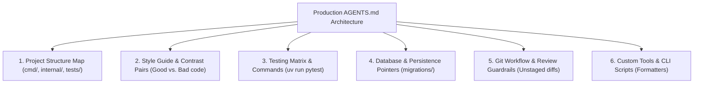

#AICoding #AgentRules #AGENTSmd #CodeStyle #GitWorkflow #Testing #SystemDesign #OpenCode

> [!abstract] Executive Summary
> Writing an effective **`AGENTS.md`** is an exercise in high-density technical specification. Generic online prompt templates filled with sycophantic roleplay (*"You are a 10x senior software architect..."*) waste valuable context tokens without improving code quality. The singular design benchmark for `AGENTS.md` is: **"What non-obvious project constraints must the model internalize at token zero to prevent wasted cycles?"**
> 
> Production-grade rule files structure instructions across **six core architectural domains**: directory layout, style guides enforced via contrast pairs ("Good" vs. "Bad" snippets), deterministic validation command matrices, database schema pointers, strict Git review workflows, and custom tool hooks. Furthermore, engineers apply the **"Leave-Out Razor"**—ruthlessly excluding secrets, language basics, and duplicated documentation by referencing satellite specifications (`docs/spec.md`).

---

## 1. The Core Philosophy: High-Density Signal vs. Fluff

An AI coding agent has already absorbed millions of open-source repositories during pre-training. It already understands basic syntax, language idioms, and standard libraries. What it lacks is **your team's local repository context and architectural opinions**.

```
┌────────────────────────────────────────────────────────────────────────────────────────┐
│                        FLUFF vs. HIGH-DENSITY SPECIFICATION                            │
└────────────────────────────────────────────────────────────────────────────────────────┘

    [ Low-Signal Fluff (Wasted Context Tokens) ]
    "You are an elite, world-class Python software engineer. Always write clean, 
     beautiful, bug-free, robust code that follows PEP 8 standards and uses functions."
    └── 0% actionable guidance. The model already defaults to this.

    [ High-Density Engineering Rule (High Leverage) ]
    "- Use single-sentence conventional commits (feat:, fix:, chore:).
     - Never stage or commit changes automatically; leave them unstaged for human review.
     - Before declaring a task complete, run all four checks:
       1. uv run pytest
       2. uv run ruff check
       3. uv run ruff format --check
       4. uv run ty check"
    └── 100% actionable constraints. Prevents broken commits and hallucinated commands.
```

---

## 2. The 6 Core Sections of a Production `AGENTS.md`



### 1. High-Level Project Structure Map
Provide a brief, high-level directory map so the agent knows which package boundaries exist.
- **Rule of Thumb:** Keep it broad. Do not list individual files; agents navigate AST trees with ease, and out-of-date file lists induce hallucinations.

```markdown
### Project Layout
- `sloperator/lexer/`    - Lexical scanner, token definitions, and token error handling.
- `sloperator/parser/`   - Recursive-descent parser and AST node structures.
- `sloperator/runtime/`  - Bytecode emitter and stack-based virtual machine.
- `tests/`               - Unit and regression test suites.
- `docs/`                - Language specifications and architectural blueprints.
```

### 2. Style Guide: The Power of Contrast Pairs
Rules stated in prose (*"write readable code"*) are ambiguous. The most effective prompting pattern for coding agents is the **Contrast Pair** ("Good" vs. "Bad" code):

```markdown
### Code Style Guide
- **Avoid unnecessary object destructuring.** Preserve namespace context using dot notation:
  ```typescript
  // GOOD: Clear context origin
  user.name;
  user.email;

  // BAD: Obscures property origin
  const { name, email } = user;
  ```
- **Error Types:** Never raise generic `Exception`. Always subclass domain errors:
  ```python
  # GOOD: Typed exception with line coordinates
  raise LexicalError(f"SlopLang lexical error at line {self.line}: unexpected '{c}'")

  # BAD: Generic unformatted error
  raise Exception("Invalid character")
  ```
```

### 3. Testing Guide & Validation Command Matrix
Agents cannot guess your test runner, command flags, or mock preferences. Provide exact bash commands:

```markdown
### Testing & Validation
- **Commands:** Always execute tests through `uv`:
  - `uv run pytest`                          - Full regression suite.
  - `uv run pytest tests/test_lexer.py -q`   - Fast iteration on lexer.
  - `uv run ruff check`                      - Static linter.
  - `uv run ruff format --check`             - Formatting compliance.
  - `uv run ty check`                        - Static type verification.
- **Mocking Policy:** Avoid mocks for pure business logic; test functions directly using pure data fixtures.
- **Regression Invariant:** Every bug fix must include a corresponding regression test in `tests/`.
```

### 4. Database Schema & Persistence
Never paste hundreds of lines of raw SQL CREATE TABLE scripts into `AGENTS.md`. Direct the agent to the schema source of truth:

```markdown
### Database & Models
- PostgreSQL schemas are managed via raw migration files in `migrations/`.
- Inspect `internal/store/models.go` for Go struct mappings.
```

### 5. Git Workflow & Review Invariants
This section governs how the agent interacts with version control. It can be placed in project `AGENTS.md` or globally in `~/.config/opencode/AGENTS.md`:

```markdown
### Git Workflow & Review Guardrails
- **Unstaged Invariant:** Never run `git add` or `git commit` unless explicitly commanded. Always leave changes unstaged for developer diff inspection.
- **Branching:** When asked to commit, push to a descriptive feature branch (`feat/lexer-error-coords`), never to `main`.
- **Rebase & Squash:** Rebase against `origin/main` before opening PRs. Squash intermediate "wip" commits into clean, atomic commits.
- **Commit Format:** Use single-sentence Conventional Commits (`feat: add escape sequence error handling`).
```

### 6. Custom Scripts & Tools
If your repository utilizes specialized shell or Python scripts for internal tasks, document their invocation:

```markdown
### Repository Tools
- To format documentation lessons, run: `uv run scripts/format_markdown.py <file>`.
```

---

## 3. The "Leave-Out" Razor: What NOT to Include

To preserve maximum context window headroom for active code editing, apply the following exclusion criteria:

```
┌────────────────────────────────────────────────────────────────────────────────────────┐
│                        THE AGENTS.md "LEAVE-OUT" RAZOR                                 │
└────────────────────────────────────────────────────────────────────────────────────────┘

    ❌ ZERO SECRETS OR CREDENTIALS
       `AGENTS.md` is committed to version control. Never paste API keys, JWTs, or passwords.

    ❌ NO DOCUMENTATION DUPLICATION
       Do not duplicate `README.md` or language specifications. Reference `docs/spec.md`.

    ❌ NO BASELINE PROGRAMMING TUTORIALS
       Do not teach the model how to write Python for-loops, Go goroutines, or TypeScript interfaces.

    ❌ NO VOLATILE LOW-LEVEL DETAIL
       Avoid listing every single function or file name. Out-of-date rules cause severe hallucinations.
```

---

## 4. Engineering Case Study: Rewriting Sloperator's Root `AGENTS.md`

Sloperator required its root instructions to be rewritten cleanly around **four specific pillars**:
1. Brief project layout.
2. The four validation commands.
3. Explicit rules on when to add regression tests.
4. A direct link to `docs/spec.md` for language grammar behavior.

### The Production `AGENTS.md`:

```markdown
# Sloperator Agent Guidelines

## 1. Project Layout
- `sloperator/` - Core compiler engine (scanner, parser, AST, and runtime).
- `tests/`      - Test suites (unit tests, grammar precedence, and regressions).
- `docs/`       - Architectural specifications and documentation.

## 2. Validation Commands
Always validate changes using `uv`:
```bash
uv run sloperator.py <file>    # Run interpreter
uv run pytest                  # Run test suite
uv run ruff check              # Lint codebase
uv run ruff format --check     # Check code formatting
uv run ty check                # Type check
```

## 3. Regression Testing Policy
- Whenever diagnosing or fixing a compiler bug, you must add an explicit regression test to `tests/` before completing the task.
- Regression tests must assert exact error messages and 1-indexed line coordinates.

## 4. Language Specification
- For formal SlopLang grammar, operator precedence rules, and syntax definitions, refer directly to `docs/spec.md`.
```

### Automated CLI Verification:
```bash
# Verify AGENTS.md contains uv run commands, regression rules, and spec reference
cat AGENTS.md | grep "uv run"
cat AGENTS.md | grep "regression"
cat AGENTS.md | grep "docs/spec.md"

# Submit verified assignment via Bootdev
bootdev run f3b94934-c1c7-418c-9c44-a12442f3a958
bootdev run -s f3b94934-c1c7-418c-9c44-a12442f3a958
```

---

## 5. Architectural Checklist for Production Rule Files

| Validation Check | Acceptance Criteria |
| :--- | :--- |
| **Token Budget** | Is `AGENTS.md` strictly under 100 lines ($\le 1,500$ tokens)? |
| **Actionability** | Does every bullet point represent a concrete constraint rather than vague advice? |
| **Single Source of Truth** | Are deep specs linked via paths (`docs/spec.md`) rather than inlined? |
| **Security Hygiene** | Is the file 100% free of plaintext credentials or environment variables? |
| **Test Verification** | Are copy-pasteable bash commands provided for all lint, test, and type checks? |
| **Diff Control** | Is the agent explicitly instructed to leave modifications unstaged? |
