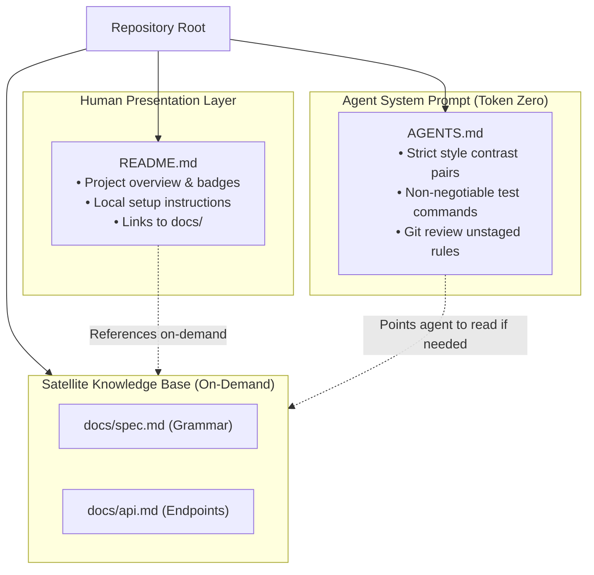

#AICoding #AgentRules #AGENTSmd #README #ContextManagement #Compilers #OperatorPrecedence #SystemDesign #OpenCode

> [!abstract] Executive Summary
> A common anti-pattern in AI-assisted software engineering is conflating human-facing documentation with agent instructions. **`README.md` is written for humans** (maintainers, users, onboarding) and can be verbose, narrative, and illustrative. In contrast, **`AGENTS.md` is written for agents ("clankers")**: it is ingested into the system prompt at token zero on *every single session*, meaning every token carries a recurring financial cost and competes for attention with your prompt.
> 
> Furthermore, an **out-of-date `AGENTS.md` is strictly worse than having no rules at all**: stale rules actively poison the agent's context, leading to confident hallucinations that override the model's native discovery tools. This note establishes the **Triad Separation Pattern** (`README.md` vs. `AGENTS.md` vs. `docs/*.md`), demonstrates the **Self-Updating Agent Feedback Loop**, and works through a full compiler case study fixing an operator precedence flaw (`<` vs. `==`) in Sloperator and locking the test command into `AGENTS.md`.

---

## 1. The Triad Separation: `README.md` vs. `AGENTS.md` vs. `docs/*.md`

To maximize developer velocity without blowing up context windows or creating conflicting instructions, repository documentation must be split across three distinct target audiences:

```
┌────────────────────────────────────────────────────────────────────────────────────────┐
│                        THE DOCUMENTATION AUDIENCE & LIFECYCLE TRIAD                    │
└────────────────────────────────────────────────────────────────────────────────────────┘

    [ 1. README.md (For Humans) ]
    • Audience: Developers, users, GitHub visitors.
    • Format: Narrative prose, badges, architecture diagrams, installation guides.
    • Ingestion: On-demand ONLY. Read by the agent only if specifically requested.

    [ 2. AGENTS.md (For Agents / Clankers) ]
    • Audience: AI coding agents (OpenCode, Claude Code, Cursor).
    • Format: Terse, constraint-dense, contrast pairs ("Good" vs "Bad"), bash commands.
    • Ingestion: ALWAYS. Injected at token zero on every turn of every session.

    [ 3. docs/*.md (Deep Satellite Specifications) ]
    • Audience: Both humans and agents.
    • Format: Formal grammar specs (`docs/spec.md`), REST/GraphQL schemas (`docs/api.md`).
    • Ingestion: On-demand JIT. Referenced by path from README and AGENTS.md.
```



### The Separation Content Matrix:
| Directive / Content | `README.md` | `AGENTS.md` | `docs/*.md` | Rationale |
| :--- | :---: | :---: | :---: | :--- |
| *"Always use slog, never fmt.Println"* | ❌ | **✔** | ❌ | Agent coding constraint; humans learn via linter or style guide. |
| *"Run tests with `uv run pytest`"* | ❌ | **✔** | ❌ | Actionable agent execution command. |
| *"Never use `.then()` over `async/await`"* | ❌ | **✔** | ❌ | Prevents agent from emitting outdated promise chaining. |
| Onboarding steps for human interns | **✔** | ❌ | ❌ | Humans need hand-holding; agents don't install desktop apps. |
| Marketing summary, logo, and badges | **✔** | ❌ | ❌ | Wastes prompt tokens if loaded into AI context. |
| Full formal AST grammar specification | ❌ | ❌ | **✔ (`docs/spec.md`)** | Too large for system prompt; agent reads on demand. |
| REST API endpoints and payload schemas | ❌ | ❌ | **✔ (`docs/api.md`)** | Inspected only when implementing HTTP endpoints. |

---

## 2. Stale Rule Poisoning: The Dangers of Outdated Rules

The most dangerous failure mode in agentic engineering is **Stale Rule Drift**.

```
┌────────────────────────────────────────────────────────────────────────────────────────┐
│                        THE STALE RULE POISONING MECHANISM                              │
└────────────────────────────────────────────────────────────────────────────────────────┘

    [ Case A: Pristine Context (No Stale Rule) ]
    User Prompt: "Write a query to fetch the user profile."
    1. Agent notices it lacks table schema.
    2. Agent calls `glob("migrations/")` and `read("migrations/002_accounts.sql")`.
    3. Agent discovers table was renamed to `accounts`.
    ✔ Result: Agent writes correct SQL: `SELECT * FROM accounts WHERE id = $1;`

    [ Case B: Poisoned Context (Stale AGENTS.md) ]
    `AGENTS.md` contains outdated rule: "User profiles reside in the `users` table."
    1. Agent reads system prompt rule: treats it as absolute ground truth.
    2. Agent skips database discovery.
    3. Agent emits broken SQL: `SELECT * FROM users WHERE id = $1;`
    💥 Result: Tests crash! Agent wastes 3 turns debugging a non-existent table.
```

> [!WARNING] The Stale Rule Axiom
> **An out-of-date `AGENTS.md` is strictly worse than having no `AGENTS.md` at all.**
> When rules are absent, the model uses its tools to discover reality. When rules are stale, the model trusts your outdated claims over the actual code.

### When to Update `AGENTS.md`:
1. **Renaming / Refactoring:** Whenever database tables, core directories, or service interfaces are renamed.
2. **Toolchain Upgrades:** When changing test runners (`pytest` $\to$ `uv run pytest`) or linters (`flake8` $\to$ `ruff`).
3. **Dependency Shifts:** Adding or removing major libraries (e.g. migrating from `requests` to `httpx`).
4. **Repeated Agent Mistakes:** Whenever the agent makes the same architectural error twice across different sessions.
5. **Model Evolution Pruning:** As models improve (e.g., from GPT-4 to Claude 3.5 Sonnet to reasoning models), prune basic guidelines that modern models handle natively.

---

## 3. The Self-Updating Agent Pattern (Closing the Feedback Loop)

To prevent rules from decaying, senior engineers embed a **meta-updating rule** in their global configuration (`~/.config/opencode/AGENTS.md`):

```markdown
# ~/.config/opencode/AGENTS.md (Meta-Update Directive)

### Continuous Rule Improvement:
When I ask you to undo an AI-written change, and the mistake isn't an obvious one-off typo or already covered in AGENTS.md:
1. Identify the root architectural misconception.
2. Suggest a concise, one-sentence edit to the project's `AGENTS.md` to prevent the same problem in future sessions.
3. Always ask for explicit human permission before applying the edit to `AGENTS.md`.
```

This transforms the agent into a self-tuning development partner: every time you hit `/undo` or correct a flawed implementation, the agent proactively drafts its own guardrails.

---

## 4. Engineering Case Study: Sloperator Operator Precedence & Rule Recording

To illustrate the interplay between bug resolution, regression test creation, and rule maintenance, consider an operator precedence defect in **Sloperator**.

### The Failure Scenario:
Evaluating the following SlopLang expression:

```sloplang
hallucinate(1 < 2 == ✅)✨
```

- **Expected Output:**
  1. Evaluate relational comparison first: `1 < 2` $\implies$ `✅` (True).
  2. Evaluate equality comparison second: `✅ == ✅` $\implies$ `✅` (True).
  3. Output: `✅`.
- **Observed Bug:**
  ```text
  SlopLang runtime error at line 1: operands of '<' must be numbers, got number and boolean
  ```

### Root Cause Analysis in `sloperator/parser/parser.py`:
In recursive-descent parsers, operator precedence is governed by the call hierarchy: **methods called deeper in the call chain bind tighter**.

```
┌────────────────────────────────────────────────────────────────────────────────────────┐
│                        STANDARD OPERATOR PRECEDENCE HIERARCHY                          │
└────────────────────────────────────────────────────────────────────────────────────────┘

    Binding Tightness          Grammar Production Rule          Parser Method
    ─────────────────          ───────────────────────          ─────────────
    Tightest (High Priority)   Primary (Literals, Grouping)     `primary()`
            │                  Unary (!, -)                     `unary()`
            │                  Factor (*, /)                    `factor()`
            │                  Term (+, -)                      `term()`
            │                  Comparison (<, <=, >, >=)        `comparison()`
    Loosest (Low Priority)     Equality (==, !=)                `equality()`
```

In the buggy parser, `comparison` was calling `equality`, or equality was inverted, causing `2 == ✅` to evaluate first (yielding boolean `False`), which was then fed into `1 < False`, triggering a type error!

### The Remediation:
In `sloperator/parser/parser.py`, enforce that `equality()` calls `comparison()`:

```python
# sloperator/parser/parser.py (Precedence Fix)

class Parser:
    # ...
    
    def equality(self) -> ASTNode:
        """Equality operators (==, !=) have lower precedence than comparison (<, <=, >, >=)."""
        expr = self.comparison()
        
        while self.match(TokenType.EQUAL_EQUAL, TokenType.BANG_EQUAL):
            operator = self.previous()
            right = self.comparison()
            expr = BinaryOpNode(left=expr, operator=operator, right=right)
            
        return expr

    def comparison(self) -> ASTNode:
        """Relational comparison (<, <=, >, >=) binds tighter than equality."""
        expr = self.term()
        
        while self.match(TokenType.LESS, TokenType.LESS_EQUAL, TokenType.GREATER, TokenType.GREATER_EQUAL):
            operator = self.previous()
            right = self.term()
            expr = BinaryOpNode(left=expr, operator=operator, right=right)
            
        return expr
```

### Step 2: Adding Regression Test in `tests/test_comparisons.py`
```python
# tests/test_comparisons.py
from sloperator.lexer.tokenizer import Tokenizer
from sloperator.parser.parser import Parser
from sloperator.runtime.interpreter import Interpreter

def test_relational_comparison_binds_tighter_than_equality():
    """Ensure 1 < 2 == ✅ evaluates as (1 < 2) == ✅ -> True."""
    code = "hallucinate(1 < 2 == ✅)✨"
    tokens = Tokenizer(code).tokenize()
    ast = Parser(tokens).parse()
    result = Interpreter().evaluate(ast)
    assert result == "✅"
```

### Step 3: Recording the Testing Command in `AGENTS.md`
To prevent future agents from wondering how to test comparisons, record the command directly in root `AGENTS.md`:

```markdown
<!-- AGENTS.md Excerpt -->
## Validation Commands
- Run compiler regression suite: `uv run pytest`
- Run comparison operator precedence tests: `uv run pytest tests/test_comparisons.py -q`
- Run linter checks: `uv run ruff check`
```

### Step 4: Verification via CLI:
```bash
# 1. Test via stdin pipeline
printf '%s\n' 'hallucinate(1 < 2 == ✅)✨' | uv run sloperator.py /dev/stdin
# Output: ✅ (exit code 0)

# 2. Run targeted comparison tests
uv run pytest tests/test_comparisons.py -q
# Output: passed (exit code 0)

# 3. Verify test command recorded in AGENTS.md
cat AGENTS.md | grep "tests/test_comparisons.py"

# 4. Submit assignment via Bootdev
bootdev run d8f9f50a-ee04-41ec-b61f-21e9d03ac4b8
bootdev run -s d8f9f50a-ee04-41ec-b61f-21e9d03ac4b8
```

---

## 5. Architectural Comparison: Maintenance Strategies

| Maintenance Vector | Static Approach (Anti-Pattern) | Continuous Calibration (Best Practice) |
| :--- | :--- | :--- |
| **Document Purpose** | Single giant README containing all instructions and docs. | Triad model: `README.md` (humans), `AGENTS.md` (agents), `docs/*.md` (specs). |
| **Updating Cadence** | Written once during repo setup, never updated. | Updated with every refactor, table rename, or recurring bug. |
| **Rule Lifecycle** | Rules accumulate indefinitely, bloating context. | Prune obsolete rules as models become more intelligent. |
| **Error Handling** | Human repeatedly corrects same mistake in chat. | Agent self-suggests `AGENTS.md` updates after `/undo`. |
| **Test Documentation** | Agent must guess test commands or scan Makefile. | Exact, copy-pasteable test commands documented in `AGENTS.md`. |
