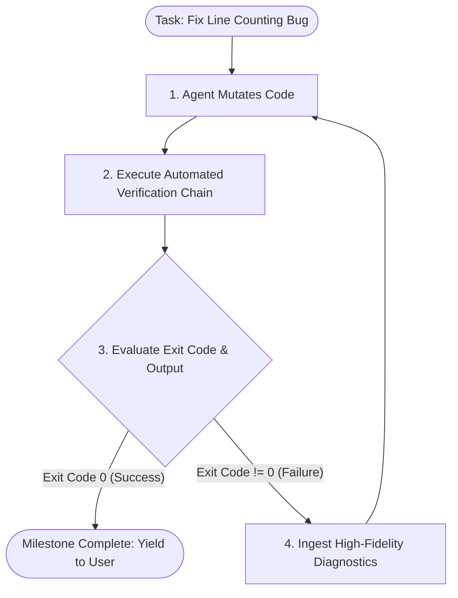

#AICoding #FeedbackLoops #Testing #Linters #TypeChecking #Compilers #Verification #SystemDesign #OpenCode

> [!abstract] Executive Summary
> Large Language Models are probabilistic next-token predictors. Without automated evaluation, code generated by an AI agent is merely a plausible-looking hypothesis. Autonomous coding agents transition from fragile "vibe-coding" to production-grade engineering only when paired with **Tight Automated Feedback Loops**: the cyclical process of **Attempt $\rightarrow$ Check $\rightarrow$ Inspect $\rightarrow$ Repeat**.
> 
> A robust feedback loop operates as an external, deterministic ground truth that validates code mutations at machine speed. By structuring verification across a **5-Tier Check Pyramid** (Compilers $\rightarrow$ Type Checkers $\rightarrow$ Linters $\rightarrow$ Formatters $\rightarrow$ Test Suites), the agent receives immediate, high-fidelity diagnostic telemetry. This prevents bad assumptions from compounding across files and enables the model to self-correct autonomously without human intervention.

---

## 1. The Autonomous Feedback Loop Lifecycle

The fundamental engine of autonomous software engineering is not the model's raw IQ; it is the **speed and precision of its feedback mechanism**.

```
┌────────────────────────────────────────────────────────────────────────────────────────┐
│                        THE 4-STAGE REVERSIBLE VERIFICATION CYCLE                       │
└────────────────────────────────────────────────────────────────────────────────────────┘

                 ┌──────────────────────────────────────────────┐
                 │ 1. ATTEMPT A CHANGE                          │
                 │    Agent edits code via `edit` or `write`    │
                 └──────────────────────┬───────────────────────┘
                                        │
                                        ▼
                 ┌──────────────────────────────────────────────┐
                 │ 2. RUN A CHECK                               │
                 │    Agent executes automated verification     │
                 │    (compiler, linter, type-check, pytest)    │
                 └──────────────────────┬───────────────────────┘
                                        │
                                        ▼
                 ┌──────────────────────────────────────────────┐
                 │ 3. INSPECT RESULTS                           │
                 │    Harness captures stdout/stderr & exit code│
                 │    Evaluates passes, failures, and traces    │
                 └──────────────────────┬───────────────────────┘
                                        │
                         ┌──────────────┴──────────────┐
                         ▼                             ▼
                 [ Tests Passed (Exit 0) ]     [ Failures Detected (Exit 1) ]
                 Proceed to next milestone     ┌────────────────────────────┐
                                               │ 4. REPEAT / REMEDIATE      │
                                               │    Agent ingests traceback │
                                               │    and adjusts hypothesis  │
                                               └─────────────┬──────────────┘
                                                             │
                                                             └─────> Loop to Step 1
```



---

## 2. Why Feedback Loops are 10x More Critical for AI Than Humans

Human software engineers possess intuition, spatial memory, and mental compilers built over years of experience. An LLM possesses none of these: it predicts text based on statistical distributions.

```
┌────────────────────────────────────────────────────────────────────────────────────────┐
│                        HUMAN vs. AI AGENT REASONING LOOPS                              │
└────────────────────────────────────────────────────────────────────────────────────────┘

    Human Engineer                              Autonomous AI Agent
    ──────────────────────────────────────      ────────────────────────────────────
    • Mental simulation catches syntax bugs.    • Blind to runtime execution states.
    • Reads compiler errors intuitively.        • Relies strictly on terminal stdout/stderr.
    • Slow iteration (minutes per check).       • Blazing execution speed (seconds per check).
    • Fatigue sets in after 5 failed attempts.  • Can attempt 15 focused cycles in 60 seconds.
```

### The Two Non-Negotiable Pillars of Effective AI Feedback:

1. **Shift-Left Early Failure (Catching Errors Instantly):**
   - If an agent introduces a subtle syntax flaw or invalid type signature in step 1, but runs no checks until step 8, it builds 7 additional layers of abstraction on top of quicksand.
   - By the time tests run, 12 files are broken, and the agent enters an unrecoverable **hallucination death spiral**.
   - Early checks catch the flaw while the blast radius is confined to a single function.

2. **Diagnostic Fidelity (Replacing Guessing with Precision):**
   - Vague feedback (*"The build failed"*) forces the LLM to guess stochastically, burning tokens across random edits.
   - High-fidelity feedback (*"`TypeError: scan_token() missing 1 required positional argument: 'source'` at `lexer.py:42`"*) gives the model the exact symbol, file, and line required for deterministic self-correction.

---

## 3. The 5-Tier Verification Pyramid

High-performance repositories structure automated checks into a progressive hierarchy ordered by **execution speed and diagnostic specificity**:

```
┌────────────────────────────────────────────────────────────────────────────────────────┐
│                        THE 5-TIER AGENT VERIFICATION PYRAMID                           │
└────────────────────────────────────────────────────────────────────────────────────────┘

                                 ▲
                                / \     [ Tier 5: E2E & Integration Tests ]
                               /   \    Slowest (10-60s). Validates distributed systems.
                              /─────\   Examples: Playwright, Docker compose test fixtures.
                             /       \
                            /─────────\   [ Tier 4: Fast Unit Tests ]
                           /           \  Medium speed (500ms - 2s). Validates business logic.
                          /─────────────\ Examples: `uv run pytest`, `go test ./...`
                         /               \
                        /─────────────────\   [ Tier 3: Linters & AST Analyzers ]
                       /                   \  Fast (100ms - 500ms). Validates syntax conventions.
                      /─────────────────────\ Examples: `uv run ruff check`, `eslint`
                     /                       \
                    /─────────────────────────\   [ Tier 2: Static Type Checkers ]
                   /                           \  Very Fast (200ms - 1s). Validates interface contracts.
                  /─────────────────────────────\ Examples: `uv run ty check`, `pyright`, `tsc`
                 /                               \
                /─────────────────────────────────\   [ Tier 1: Compilers & Formatters ]
               /                                   \  Blazing (< 100ms). Validates grammar & syntax.
              /─────────────────────────────────────\ Examples: `cargo check`, `ruff format --check`
```

### Execution Strategy for Agents:
- **During Iteration:** The agent executes Tier 1, 2, and targeted Tier 4 checks on the specific file touched (`uv run pytest tests/test_lexer.py -q`).
- **Before Milestone Completion:** The agent executes the entire pipeline sequentially:
  ```bash
  uv run ruff format --check && uv run ruff check && uv run ty check && uv run pytest
  ```

---

## 4. Hardening the Feedback Loop in `AGENTS.md`

To guarantee that an agent never skips verification, the validation commands must be declared as **mandatory completion invariants** in the repository's `AGENTS.md`:

```markdown
# AGENTS.md (Verification Invariants)

## Completion Guardrails
Never report a task as complete without executing and passing the four-step verification chain:

1. Format Verification:
   ```bash
   uv run ruff format --check
   ```
2. Static Linter:
   ```bash
   uv run ruff check
   ```
3. Type Contract Verification:
   ```bash
   uv run ty check
   ```
4. Regression Test Suite:
   ```bash
   uv run pytest
   ```

If any command returns a non-zero exit code:
- Read the exact traceback from stderr.
- Fix the root cause without modifying unrelated files.
- Re-run the failing check before moving to the next tier.
```

---

## 5. Architectural Comparison: Unchecked vs. Loop-Bounded Agents

| Operational Dimension | Unchecked Vibe-Coding (Anti-Pattern) | Hardened Feedback Loop (Best Practice) |
| :--- | :--- | :--- |
| **Error Discovery** | Discovered by human minutes or hours later. | Caught in seconds at the terminal by the agent harness. |
| **Blast Radius** | Spreads across multiple files and dependent modules. | Confined strictly to the current function or file mutation. |
| **Debugging Cost** | High: Multi-turn human arguments, context bloat. | Low: Model reads stderr traceback and fixes error in 1 turn. |
| **Code Correctness** | Probabilistic (looks like code, may not execute). | Deterministic (passes compiler, linter, types, and tests). |
| **Developer Role** | Exhausted babysitter reading hundreds of diff lines. | High-leverage auditor reviewing pre-tested, verified commits. |
