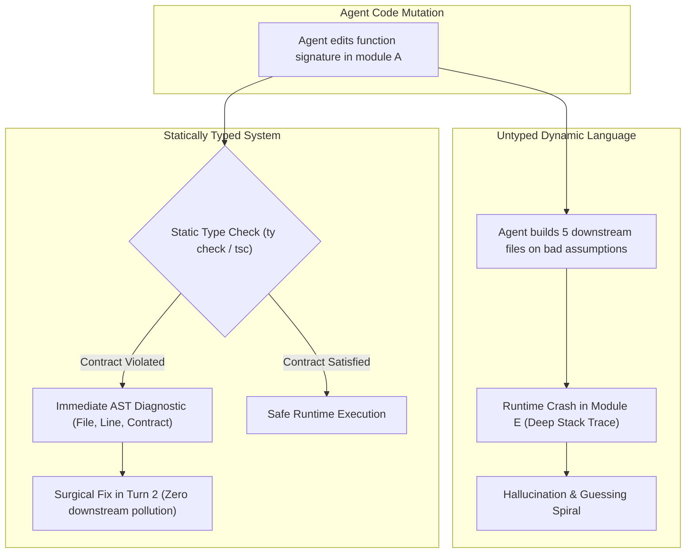

#AICoding #StaticTyping #TypeSafety #CompileTimeContracts #Guardrails #Pyright #TypeScript #OpenCode #SystemDesign

> [!abstract] Executive Summary
> In traditional software engineering, static type systems provide developer productivity benefits through IDE autocompletion and compile-time safety. In **autonomous AI engineering, static typing is an existential necessity**. Because Large Language Models generate code probabilistically, dynamic languages without type annotations allow subtle semantic mismatches to slip past syntax parsers, triggering catastrophic runtime errors deep within production call stacks.
> 
> Static analysis tools (such as `ty check`, `pyright`, `mypy`, and `tsc`) act as **zero-runtime-cost guardrails**: they evaluate whether a function call violates argument contracts, accesses missing fields, or returns incompatible types **before a single line of code is executed**. By transforming fuzzy stochastic generation into verifiable Abstract Syntax Tree (AST) invariants, static typing prevents compounding cross-file errors and provides the agent with unambiguous, machine-speed diagnostic telemetry.

---

## 1. Why Static Typing is 10x More Valuable for AI Than Humans

Human engineers rarely write code that calls a function with completely inverted argument types or accesses non-existent attributes on a dictionary. LLMs, however, frequently do: they rely on fuzzy attention across similar naming patterns.

```
┌────────────────────────────────────────────────────────────────────────────────────────┐
│                        DYNAMIC TYPING vs. STATIC TYPE GUARDRAILS                       │
└────────────────────────────────────────────────────────────────────────────────────────┘

    [ Dynamic Untyped Python / JavaScript ]
    1. Agent refactors `Tokenizer.scan(code: str) -> list[Token]`
       to `Tokenizer.scan(code: str, line_offset: int = 1) -> TokenStream`
    2. Agent does not run the code yet.
    3. Agent proceeds to write 400 lines of Parser code assuming old return type (`list`).
    4. At runtime: 💥 `AttributeError: 'TokenStream' object has no attribute 'pop'`
    5. The agent enters a 6-turn debugging spiral, corrupting previously working code!

    [ Static Typed Architecture (ty check / pyright / tsc) ]
    1. Agent refactors `Tokenizer.scan()` signature.
    2. Agent executes: `uv run ty check` (200 milliseconds).
    3. Typechecker outputs 4 precise errors:
       `sloperator/parser/parser.py:52: error: Argument 1 to "Parser" has incompatible type "TokenStream"; expected "list[Token]"`
    4. Agent sees exact file, line, and expected type contract.
    5. Agent fixes all call sites in Turn 2 before writing further code!
```



---

## 2. The 4 Major Failures Caught Instantly at Zero Runtime Cost

A static typechecker verifies structural AST properties without spinning up web servers, connecting to databases, or establishing network sockets:

```
┌────────────────────────────────────────────────────────────────────────────────────────┐
│                        THE 4 COMPILE-TIME TYPE INVARIANTS                              │
└────────────────────────────────────────────────────────────────────────────────────────┘

    1. Arity & Parameter Type Violations
       def tokenize(source: str, line: int) -> list[Token]: ...
       Calling `tokenize(source)` or `tokenize(source, "1")` is flagged instantly.

    2. Incompatible Return Types
       def parse() -> ASTNode:
           if error: return None  # Error: Incompatible return type (Optional[ASTNode])
       Forces the agent to explicitly handle nullable or error-union states.

    3. Non-Existent Attribute / Field Access
       node.val vs. node.value vs. node.lexeme
       Prevents runtime `AttributeError` or JavaScript `undefined` dereferences.

    4. Downstream Interface & Protocol Breakages
       Modifying an interface in `core/` immediately flags all 12 implementing classes,
       giving the agent a complete, deterministic to-do list.
```

---

## 3. The Compounding Error Cascade

The most expensive failure mode in AI coding sessions is **The Compounding Error Cascade**. 

When an agent changes an internal interface in a dynamic codebase, it has no automated mechanism to know which downstream callers were broken. It assumes everything is fine, implements three more features, and only runs tests at the very end.

```
┌────────────────────────────────────────────────────────────────────────────────────────┐
│                        THE COMPOUNDING ERROR CASCADE (Token Bleed)                     │
└────────────────────────────────────────────────────────────────────────────────────────┘

    Step 1: Agent changes `User` dict schema in auth.py. (No type checks)
    Step 2: Agent edits billing.py using the new schema.
    Step 3: Agent edits notifications.py using the OLD schema (hallucination).
    Step 4: Agent edits reporting.py using a THIRD schema.
    Step 5: Agent runs tests. 18 tests fail with 18 different tracebacks!
    
    💥 Total tokens burned: 140,000 tokens across 12 turns.
    💥 Result: The session is completely poisoned and must be scrapped.
```

In a statically typed codebase, running `ty check` at Step 1 immediately halts the agent:
> *"Notifications.py line 44: Property 'email' does not exist on type 'UserAccount'."*

The agent cannot proceed until the type contract is satisfied. **The error is suffocated in the crib.**

---

## 4. Modern Static Typecheckers in the AI Toolchain

| Ecosystem | Tool | Command | Characteristics |
| :--- | :--- | :--- | :--- |
| **Python** | **`ty`** (Astral) | `uv run ty check` | Blazing Rust-based static typechecker; instant CLI feedback. |
| **Python** | **Pyright / Basedpyright** | `pyright` | Microsoft's fast, strict typechecker; gold standard for strict type safety. |
| **Python** | **Mypy** | `mypy .` | Canonical Python type checker; comprehensive plugin ecosystem. |
| **TypeScript** | **`tsc`** | `tsc --noEmit` | Validates TypeScript types across the entire project without emitting JS files. |
| **Rust** | **`cargo`** | `cargo check` | Validates types, syntax, and borrow checker without slow LLVM codegen. |
| **Go** | **`go`** | `go vet ./...` | Native static analyzer for Go interface and struct correctness. |

> [!TIP] The `--noEmit` / Fast Check Pattern
> When integrating typechecks into agent workflows, never run full builds or bundlers (e.g. `webpack` or `cargo build`). Run dedicated type-checking passes (`tsc --noEmit`, `cargo check`, `uv run ty check`). They complete in **hundreds of milliseconds**, keeping the agent's feedback loop blazing fast.

---

## 5. Architectural Conventions for AI-Friendly Type Safety

To maximize the effectiveness of coding agents, software architects enforce specific typing conventions in repository `AGENTS.md` files:

```markdown
# AGENTS.md (Type Safety Conventions)

### Type Annotations:
- **Mandatory Signatures:** All function and method signatures must include strict type annotations for all parameters and return values.
- **No Untyped Dictionaries:** Avoid returning raw `dict` from business functions. Use `@dataclass(frozen=True)`, `NamedTuple`, `TypedDict`, or Pydantic models.
- **Explicit Nullability:** Never allow implicit `None`. Always use `T | None` (or `Optional[T]`) and narrow nullable types using `if x is not None:` guards.
- **Verification Rule:** Always run `uv run ty check` after any function signature modification.
```

---

## 6. Synthesis: The Type Safety ROI Matrix

```
┌────────────────────────────────────────────────────────────────────────────────────────┐
│                        STATIC TYPING RETURN ON INVESTMENT (ROI)                        │
└────────────────────────────────────────────────────────────────────────────────────────┘

    Metric                      Untyped Codebase          Statically Typed Codebase
    ───────────────────────     ──────────────────────    ─────────────────────────
    Feedback Latency            5 - 30 seconds (Runtime)  200 milliseconds (Static AST)
    Error Localization          Fuzzy runtime exception   Exact file, line, and symbol
    Agent Guessing Factor       High (trial & error)      Zero (guided by compiler contract)
    Compounding Multi-File Risk Severe                    Completely blocked
    Token Burn Per Bug Fix      25,000 - 80,000 tokens    2,000 - 8,000 tokens (75%+ savings)
```
