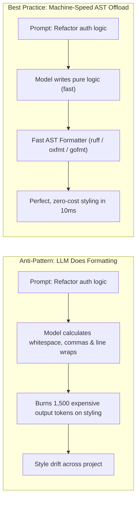

#AICoding #Formatting #TokenEconomics #Ruff #Oxfmt #Gofmt #CodeQuality #OpenCode #SystemDesign

> [!abstract] Executive Summary
> Relying on a Large Language Model to manually manage whitespace, indentation, trailing commas, and line length is a severe **token economic anti-pattern**. Because output tokens are the most expensive computational resource in LLM inference (costing $3\times$ to $5\times$ more than input tokens and generating at human-perceptible latencies), forcing an agent to compute stylistic token alignments burns budget while inevitably producing inconsistent styling across large diffs.
> 
> Production AI engineering offloads formatting entirely to **deterministic, machine-speed AST/CST formatters** (such as `ruff format`, `oxfmt`, and `gofmt`). Furthermore, to preserve engineering velocity, formatting must be executed using the **"Final-Step Deferral Pattern"**: formatting is deferred until all logical and behavioral changes pass verification, preventing intermediate diff noise and unnecessary file-watcher thrashing.

---

## 1. The Token Tax of LLM Code Formatting

When an autoregressive LLM generates code without an automated formatter, it must dedicate internal attention heads and output tokens to mechanical styling decisions:

```
┌────────────────────────────────────────────────────────────────────────────────────────┐
│                        THE MECHANICAL FORMATTING TOKEN TAX                             │
└────────────────────────────────────────────────────────────────────────────────────────┘

    [ LLM Formatting Manually (Output Token Bleed) ]
    • Generates 4 leading space tokens per indentation level.
    • Computes 80-character line wraps token-by-token.
    • Balances trailing commas across multi-line argument lists.
    • Alternates single vs. double quotes based on stochastic sampling.
    
    💥 Consequence 1: 15% - 25% of generated output tokens are pure whitespace!
    💥 Consequence 2: Inconsistent conventions across files (e.g. 2 spaces vs 4 spaces).
    💥 Consequence 3: Output tokens are billed at highest tier ($15/1M vs $3/1M input).

    [ Automated Offloading (ruff format / oxfmt / gofmt) ]
    • LLM generates unformatted or roughly formatted logic as fast as possible.
    • Native Rust/Go binary formats 1,000 files in 15 milliseconds.
    • 100% deterministic mathematical consistency; zero token waste.
```



---

## 2. Modern Blazing-Fast Formatters for Agent Toolchains

In the era of autonomous coding agents, legacy JavaScript-based formatters that take 3–10 seconds to format a repository introduce unacceptable feedback lag. Modern agent workflows demand **native compiled formatters** that complete in milliseconds:

| Language / Domain | Recommended Formatter | Engine | Benchmark Performance | Key Advantage |
| :--- | :--- | :--- | :--- | :--- |
| **Python** | **`ruff format`** (Astral) | Rust | 100x faster than Black/isort | Replaces Black and isort with zero configuration; instant CLI feedback. |
| **JS / TS / Web** | **`oxfmt`** (Oxc Project) | Rust | 50x faster than Prettier | Formats TS, JS, JSON, HTML, CSS, and Markdown with drop-in Prettier compatibility. |
| **JS / TS** | **`biome format`** | Rust | Sub-millisecond formatting | Unified linter and formatter for modern JavaScript web projects. |
| **Go** | **`gofmt` / `goimports`** | Go Native | Single-digit milliseconds | Universal Go standard; eliminates all formatting debates by definition. |
| **Rust** | **`cargo fmt`** | Rust Native | Near-instantaneous | Canonical Rustfmt engine integrated with Cargo. |

---

## 3. The "Final-Step Deferral" Pattern

A common mistake in agent workflow automation is instructing the agent to format files after every single micro-edit.

### Why Frequent Formatting Harms Velocity:
1. **Noisy Intermediate Diffs:** Running a formatter on turn 1 alters indentation across 80 lines of code. When the agent reviews its own `git diff` on turn 2 to debug a logic issue, the diff is cluttered with whitespace changes, obscuring the actual semantic bug.
2. **File Watcher Thrashing:** Continuous formatting triggers repeated filesystem save events, forcing language servers and OpenCode file watchers to re-index constantly.
3. **Execution Lag:** Adding 500ms of formatting on every turn compounds across 15 agentic turns.

```
┌────────────────────────────────────────────────────────────────────────────────────────┐
│                        THE FINAL-STEP DEFERRAL WORKFLOW                                │
└────────────────────────────────────────────────────────────────────────────────────────┘

    Step 1: Code Mutation (Implement logic, refactor functions).
       │
       ▼
    Step 2: Type Verification (`uv run ty check` or `tsc --noEmit`).
       │
       ▼
    Step 3: Behavioral Test Suite (`uv run pytest` or `go test ./...`).
       │
       ▼ (Iterate between Steps 1 - 3 until all checks pass cleanly)
       │
    Step 4: FINAL STEP DEFERRED EXECUTION
       ├── Run Formatter: `uv run ruff format` or `oxfmt`
       └── Run Linter Fixes: `uv run ruff check --fix`
       │
       ▼
    Step 5: Yield Verified, Cleanly Formatted Commit to Developer!
```

---

## 4. Configuring Formatting in `AGENTS.md`

To ensure agents automate formatting without running it prematurely, declare it as a **terminal invariant** in `AGENTS.md`:

```markdown
# AGENTS.md (Formatting Policy)

## Code Formatting Rules
- **Do not worry about micro-formatting during initial edits.** Focus on structural and logical correctness first.
- **Run the formatter ONLY as the final step** after all unit tests and type checks have succeeded:
  ```bash
  # Python
  uv run ruff format
  
  # TypeScript / Web
  npx oxfmt --write .
  
  # Go
  gofmt -w .
  ```
- **Never report a task as complete if `ruff format --check` fails.**
```

---

## 5. Architectural Benefits Summary

```
┌────────────────────────────────────────────────────────────────────────────────────────┐
│                        FORMATTING AUTOMATION: ROI SUMMARY                              │
└────────────────────────────────────────────────────────────────────────────────────────┘

    Metric                      Manual LLM Formatting    AST Formatter Offload
    ───────────────────────     ─────────────────────    ─────────────────────
    Token Cost Per Turn         +15% - 25% output burn   0% output token overhead
    Stylistic Consistency       Stochastic / variable    100% mathematical invariant
    Diff Readability            Cluttered by whitespace  Surgical, semantic only
    Feedback Loop Latency       High (LLM generation)   10 milliseconds (Native binary)
    Mental Load on Model        Divided attention        100% focused on logic & tests
```
