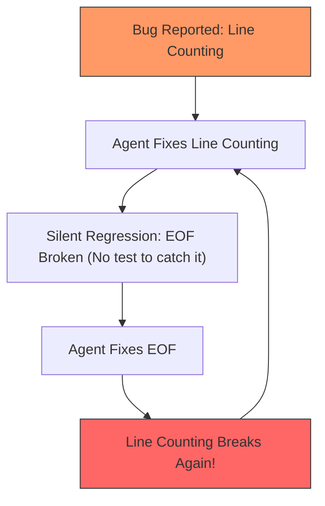

#AICoding #Testing #UnitTest #IntegrationTest #WhackAMole #RegressionTesting #Pytest #SystemDesign #OpenCode

> [!abstract] Executive Summary
> Compilers, linters, and static typecheckers guarantee that code is **structurally valid**; only **automated test suites** prove that code **does the right thing**. An AI agent can effortlessly emit syntactically flawless, type-safe code that computes the complete inverse of business requirements.
> 
> Without comprehensive, fast test suites, agents inevitably fall into the **"Whack-a-Mole" Regression Trap**: fixing one edge case while silently breaking adjacent functionality in an endless cycle. Autonomous self-correction relies on a dual-tier testing strategy: **Table-Driven Unit Tests** executed at sub-second latencies for rapid local feedback, paired with **Integration Tests** executed at milestone boundaries to validate realistic end-to-end subsystem behavior.

---

## 1. Structure vs. Behavior: The Verification Divide

A common architectural trap in AI engineering is relying solely on compilers and linters to validate agentic changes:

```
┌────────────────────────────────────────────────────────────────────────────────────────┐
│                        STRUCTURE vs. BEHAVIORAL VERIFICATION                           │
└────────────────────────────────────────────────────────────────────────────────────────┘

    Static Analyzers (Compilers, Types, Linters)    Automated Test Suites (Unit & Integration)
    ────────────────────────────────────────────    ─────────────────────────────────────────
    • "Is this valid syntax?"                       • "Does this function return the right value?"
    • "Do the argument types match?"                • "Does this handle empty strings correctly?"
    • "Are imported symbols defined?"               • "Does this write the correct record to SQL?"
    
    Verdict: Structural Validity                    Verdict: Behavioral Correctness
```

An agent tasked with calculating tax can write:
```python
def calculate_tax(subtotal: float, rate: float) -> float:
    return subtotal - rate  # Structurally valid! Perfectly typed! Completely wrong logic!
```
Typecheckers will report 0 errors. Only an automated test asserting `calculate_tax(100.0, 0.08) == 8.0` will catch the semantic error.

---

## 2. The "Whack-a-Mole" Regression Trap

When developers complain that an AI agent *"fixes one bug, but breaks something else"*, the root cause is almost never the model's intelligence: **it is thin test coverage or an absent test loop**.

```
┌────────────────────────────────────────────────────────────────────────────────────────┐
│                        THE WHACK-A-MOLE REGRESSION CYCLE                               │
└────────────────────────────────────────────────────────────────────────────────────────┘

    Turn 1: Developer: "Fix scanner line-counting bug for comments."
            Agent edits scanner.py to advance line count on comments.
            Manual verification: Line counting works!
            
    Turn 2: Developer: "Wait, now multiline comments crash on EOF!"
            Agent edits scanner.py to handle EOF.
            Manual verification: EOF works!
            
    Turn 3: Developer: "Now empty lines are being counted twice!"
            Agent edits scanner.py to skip empty lines.
            💥 Result: Turn 1's line counting bug has returned!
```



### The Two Root Causes of Whack-a-Mole:
1. **Thin Test Coverage:** The repository only tests the "happy path." Edge cases and historical bug fixes have no automated assertions guarding them.
2. **Slow / Omitted Test Loops:** The agent tests only the single scenario mentioned in the prompt, skipping the broader test suite because it takes too long to run.

---

## 3. The Dual-Tier Testing Strategy for AI Agents

To eliminate regressions without sacrificing iteration speed, testing is divided into two operational tiers:

```
┌────────────────────────────────────────────────────────────────────────────────────────┐
│                        THE DUAL-TIER TESTING ARCHITECTURE                              │
└────────────────────────────────────────────────────────────────────────────────────────┘

    [ Tier 1: Fast Local Unit Tests ]
    • Target: Pure business logic, AST parsing, regexes, string parsing.
    • Speed: Sub-second (< 1s for hundreds of tests).
    • Execution Cadence: Executed after EVERY single code mutation.
    • Tooling: `uv run pytest tests/test_lexer.py -q`, `go test ./pkg/lexer`

    [ Tier 2: Comprehensive Integration Tests ]
    • Target: Database queries, HTTP endpoints, CLI process execution.
    • Speed: 5 - 30 seconds.
    • Execution Cadence: Executed at milestone boundaries before declaring task complete.
    • Tooling: `uv run pytest tests/test_integration/`, `go test ./...`
```

---

## 4. The Gold Standard for AI: Table-Driven Testing

The most effective testing pattern for AI agents is **Table-Driven Testing** (popularized by Go and supported in Python via `pytest.mark.parametrize`).

A table-driven test separates the test logic from the test data, providing a structured matrix of inputs, expected outputs, and error scenarios:

```python
# tests/test_scanner_table.py
import pytest
from sloperator.lexer.scanner import Scanner
from sloperator.lexer.exceptions import LexicalError

# The Table Matrix: Explicit inputs and expected line outcomes
TEST_CASES = [
    # (name, source_code, expected_error_line)
    ("single_comment_then_error", "— a comment\n@", 2),
    ("multiline_comments_blank_lines", "— first\n\n— third\n@", 4),
    ("error_at_start", "@", 1),
    ("multiple_blank_lines", "\n\n\n@", 4),
]

@pytest.mark.parametrize("name,source,expected_line", TEST_CASES)
def test_scanner_line_accuracy(name, source, expected_line):
    """Table-driven test validating scanner line coordinates across edge cases."""
    scanner = Scanner(source)
    with pytest.raises(LexicalError) as exc_info:
        while not scanner.is_at_end():
            scanner.scan_token()
            
    assert f"at line {expected_line}" in str(exc_info.value), f"Failed on case: {name}"
```

### Why Table-Driven Tests Supercharge AI Agents:
1. **Zero Hallucination Surface:** The model does not need to invent new test functions with mocking fixtures; it simply appends a new tuple `("new_case", "code", line)` to the array.
2. **Instant Multi-Regression Defense:** When the agent attempts a fix for case 4, running `pytest` automatically re-evaluates cases 1, 2, and 3 simultaneously. If the fix breaks case 2, the agent sees `FAILED test_scanner_line_accuracy[multiline_comments_blank_lines]` and corrects the logic before reporting back.

---

## 5. Defensive Testing Guardrails in `AGENTS.md`

To automate self-correcting behavior, document test execution protocols directly in `AGENTS.md`:

```markdown
# AGENTS.md (Testing Protocols)

## Regression Invariant
- **Never fix a bug without adding a regression test.**
- If fixing a bug in `sloperator/parser/`, add a test case to `tests/test_parser.py` reproducing the failure before altering the source code.

## Test Execution Workflow
1. **During Iteration:** Run only the relevant test file with quiet output for instant feedback:
   ```bash
   uv run pytest tests/test_comparisons.py -q
   ```
2. **Before Completion:** Always run the complete regression test suite:
   ```bash
   uv run pytest
   ```
3. **Whack-a-Mole Prevention:** If an edit causes an existing test to fail, do not alter the existing test. Fix your implementation to satisfy both the new and old tests.
```

---

## 6. Synthesis: The Complete Verification Spectrum

```
┌────────────────────────────────────────────────────────────────────────────────────────┐
│                        THE COMPLETE AI VERIFICATION SPECTRUM                           │
└────────────────────────────────────────────────────────────────────────────────────────┘

    Check Type         Tool Example           Validation Scope             Latency
    ──────────         ────────────           ────────────────             ───────
    Syntax/Format      `ruff format --check`  Whitespace & token layout    10 ms
    Linter             `ruff check`           Dead code, unused imports    100 ms
    Type Checker       `ty check` / `tsc`     AST contracts & nullability  200 ms
    Unit Tests         `pytest -q`            Business logic & edge cases  500 ms - 2s
    Integration Tests  `pytest tests/e2e/`    Realistic subsystem flows    10s - 30s
```
