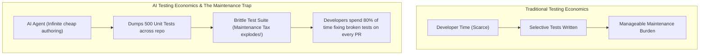
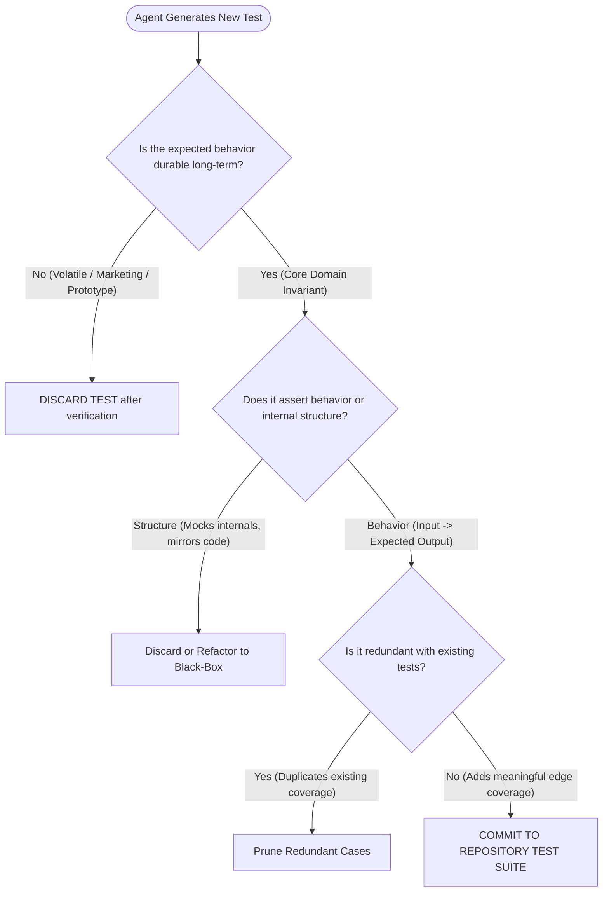

#AICoding #TestEconomics #Testing #EphemeralTests #RegressionTesting #CodeQuality #TechnicalDebt #SystemDesign #OpenCode

> [!abstract] Executive Summary
> Autonomous AI agents have driven the marginal cost of **authoring** unit tests to near zero: an agent can generate dozens of comprehensive test cases in seconds. However, **"cheap to write" does not mean "free to maintain."** Every test committed to a repository imposes an ongoing **Maintenance Tax (OpEx)**: executing in CI pipelines, requiring updates during refactors, and creating friction when business specifications evolve.
> 
> Production engineering requires an architectural filter: **Permanent Invariant Tests vs. Ephemeral Scaffolding Tests**. Stable domain logic (data parsers, compiler lexers, cryptography, mathematical algorithms) warrants permanent, committed regression tests. Conversely, volatile or experimental features (marketing messaging, dynamic onboarding funnels, exploratory prototypes) should utilize **disposable tests**—run locally to verify correctness during implementation, then discarded before committing to prevent brittle test churn.

---

## 1. The Shifting Economics of Software Testing

Historically, test coverage was constrained by human developer time and cognitive fatigue (high authoring CapEx). Teams frequently skipped tests for edge cases because manual authoring was too slow.

AI agents invert this economic equation:

```
┌────────────────────────────────────────────────────────────────────────────────────────┐
│                        THE SHIFT IN SOFTWARE TEST ECONOMICS                            │
└────────────────────────────────────────────────────────────────────────────────────────┘

    Traditional Software Engineering            The AI Agent Paradigm
    ────────────────────────────────            ──────────────────────
    Authoring Cost: HIGH (hours of manual work) Authoring Cost: NEAR ZERO (seconds of LLM compute)
    Maintenance Cost: HIGH                      Maintenance Cost: EXPONENTIALLY HIGHER if uncurated
    Bottleneck: Developer writing speed         Bottleneck: Test suite curation & signal-to-noise
    Coverage Target: Hard to reach 80%          Coverage Target: Trivial to hit 100% (vanity metric)
```



> [!IMPORTANT] The 100% Coverage Vanity Metric
> Code coverage measures which lines were touched by a test, not whether the test asserts meaningful behavioral invariants. Blindly generating 1,000 brittle AI tests to achieve "100% coverage" creates massive technical debt. **Tests are code, and code is a liability.**

---

## 2. Permanent Invariant Tests vs. Ephemeral Scaffolding

Senior software engineers distinguish between tests meant for **long-term regression defense** and tests meant for **short-term execution scaffolding**:

```
┌────────────────────────────────────────────────────────────────────────────────────────┐
│                        PERMANENT INVARIANTS vs. EPHEMERAL SCAFFOLDING                  │
└────────────────────────────────────────────────────────────────────────────────────────┘

    [ Category 1: Permanent Invariant Tests (KEEP & COMMIT) ]
    • Characteristics: High behavioral durability; specification will persist for years.
    • Examples:
      - Regex / Lexer token scanning logic.
      - Email address extraction from PDF streams.
      - Financial tax calculation rounding invariants.
      - Authentication token signature verification.
    • Action: Commit to `tests/` and run on every CI/CD pull request.

    [ Category 2: Ephemeral Scaffolding Tests (DISCARD BEFORE COMMIT) ]
    • Characteristics: Low behavioral durability; volatile requirements subject to rapid change.
    • Examples:
      - Exact wording of a Discord greeting message for new marketing campaigns.
      - Temporary UI layout ordering in an exploratory A/B test.
      - Intermediate helper functions during a prototype refactoring.
    • Action: Let the agent write them, run them to verify the change, then `git checkout` / discard!
```

### The Concrete PDF vs. Discord Example:

1. **The PDF Email Extractor (Keep):**
   ```python
   def extract_emails(pdf_bytes: bytes) -> list[str]: ...
   ```
   *Lifecycle:* A valid email format and PDF byte stream will not change next month. Committing 20 edge-case tests (handling malformed bytes, weird encodings, multiple `@` symbols) permanently protects production stability. **Commit these tests.**

2. **The Discord Marketing Greeting (Discard):**
   ```python
   def format_welcome_message(username: str, tier: str) -> str:
       return f"Hey {username}! Welcome to the VIP Lounge!"
   ```
   *Lifecycle:* Next week, the marketing team will change the greeting to *"Welcome aboard, legend!"*. If you committed unit tests asserting the exact string `"VIP Lounge"`, your CI pipeline breaks next week on an intentional copy change. You now have to rewrite the tests. **Use ephemeral tests for verification, then discard.**

---

## 3. The Test Retention Decision Framework

When an agent generates a suite of new unit tests, apply the following architectural filter before committing:



### The Three Retention Questions:
1. **Durability:** *If this test fails 6 months from now, does it indicate a critical bug, or did a human intentionally change the feature?* (If the latter, it's a candidate for deletion).
2. **Black-Box vs. White-Box:** *Does the test assert public interface behavior, or is it tightly coupled to private internal helper functions?* (Tests coupled to private methods break during harmless internal refactors).
3. **Signal-to-Noise Ratio:** *Does this test cover a distinct equivalence partition or boundary condition, or is it an echo of another test?*

---

## 4. The High-ROI Use Case: Legacy Characterization Backfilling

While generating tests for volatile new code can be wasteful, AI agents deliver exceptional ROI when **backfilling tests for stable, undertested legacy systems**:

```
┌────────────────────────────────────────────────────────────────────────────────────────┐
│                        LEGACY CHARACTERIZATION TESTING WORKFLOW                        │
└────────────────────────────────────────────────────────────────────────────────────────┘

    [ Step 1: Identify Stable Legacy Code ]
    • Code in production for 2 years with 0 unit tests.
    • Working correctly, but terrifying to refactor because there is no safety net.

    [ Step 2: Agent Characterization Prompt ]
    "Read `legacy_billing.py`. Write a comprehensive table-driven test suite in
     `tests/test_legacy_billing.py` asserting the CURRENT observable behavior
     across edge cases. Do NOT modify the source code; only write tests."

    [ Step 3: Golden Master Baseline Locked ]
    • 40 unit tests pass against the existing code, locking in behavioral invariants.

    [ Step 4: Fearless Modernization / Refactoring ]
    • The agent refactors the legacy code; any regression immediately trips the baseline!
```

---

## 5. Anti-Patterns in AI-Generated Test Suites

```
┌────────────────────────────────────────────────────────────────────────────────────────┐
│                        AI TEST SUITE ANTI-PATTERNS                                     │
└────────────────────────────────────────────────────────────────────────────────────────┘

    1. The Mocking Mirror
       Agent generates a test that mocks out 8 dependencies and asserts:
       `mock_db.query.assert_called_once_with(...)`
       Failure: Tests nothing about real database behavior; breaks whenever query is optimized.

    2. The Brittle Snapshot
       Agent dumps 4,000 lines of JSON or HTML into a snapshot assertion.
       Failure: Any minor timestamp or whitespace addition causes CI to fail.

    3. The Tautological Assertion
       `assert result == function_under_test(input)`
       Failure: Model generates assertions that re-execute the code or assert trivialities
       (`assert isinstance(result, object)`).

    4. The Redundant Multiplier
       Generating 30 test functions that test `add(1, 2)`, `add(2, 3)`, `add(3, 4)`
       instead of a single parametrized table covering `(positive, negative, zero, overflow)`.
```

---

## 6. Synthesis: Test Economics Best Practices for `AGENTS.md`

```markdown
# AGENTS.md (Test Hygiene & Retention Rules)

## Test Authoring Principles
- **Favor Black-Box Behavioral Tests:** Test functions and classes through their public APIs; avoid mocking internal helper methods.
- **Parametrize Equivalence Partitions:** Use table-driven matrices (`pytest.mark.parametrize`) to test distinct boundaries (empty, normal, maximum, invalid).
- **No Brittle Snapshot Assertions:** Assert specific key-value pairs or error codes rather than full serialized text dumps.
- **Ephemeral Test Discard Rule:** When building experimental features or transient UI strings, run tests locally for verification, but do not commit tests that assert volatile wording.
```
