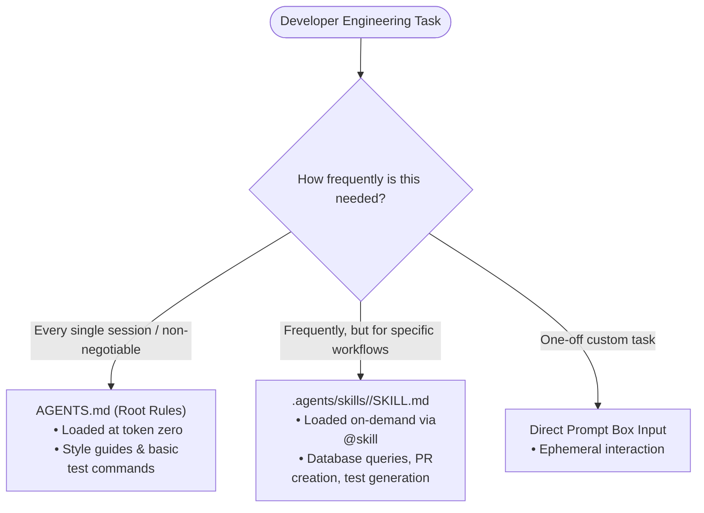

#AICoding #AgentSkills #Skills #WorkflowAutomation #PromptEngineering #OpenCode #SystemDesign

> [!abstract] Executive Summary
> In autonomous software engineering, a **Skill** is a modular, reusable prompt and workflow definition encapsulated within a directory containing a structured **`SKILL.md`** file. Skills resolve the core trade-off between typing redundant, complex prompts by hand and stuffing every potential workflow into `AGENTS.md`—which would permanently bloat the system prompt and dilute model attention during unrelated tasks.
> 
> Skills reside in standardized discovery roots (`.agents/skills/` across multi-agent harnesses, `.opencode/skills/` natively, and `.claude/skills/` for Anthropic compatibility) and can be invoked on-demand via the **`@skill_name`** syntax or the interactive **`/skills`** picker. By packaging specialized procedures—such as safe read-only database exploration, PR drafting, or full multi-tier project validation—skills provide repeatable, high-leverage workflows without incurring recurring token overhead across every session.

---

## 1. The Architectural Triad: Prompts vs. Rules vs. Skills

To prevent context window bloat while eliminating repetitive typing, software engineers structure instructions across three distinct operational tiers:

```
┌────────────────────────────────────────────────────────────────────────────────────────┐
│                        THE PROMPT vs. AGENTS.md vs. SKILL SPECTRUM                     │
└────────────────────────────────────────────────────────────────────────────────────────┘

    [ Tier 1: Interactive Ad-Hoc Prompts ]
    • Characteristics: Single-use, highly contextual, transient.
    • Example: "Fix the off-by-one error on line 42 of scanner.py."
    • Limitation: Tedious and error-prone to retype for complex, multi-step workflows.

    [ Tier 2: Persistent Repository Rules (AGENTS.md) ]
    • Characteristics: Ingested at token zero on EVERY single session turn.
    • Example: "Never commit directly to main; always leave changes unstaged."
    • Limitation: Adding 20 specialized workflows here burns thousands of recurring tokens.

    [ Tier 3: Modular On-Demand Skills (@skill) ]
    • Characteristics: Loaded into context ONLY when explicitly invoked or needed.
    • Example: `@validate`, `@talk-to-database`, `@create-test-program`.
    • Advantage: Zero recurring token cost; maximum prompt repeatability.
```



---

## 2. Anatomy of a Skill: The `SKILL.md` Specification

A skill is physically structured as a dedicated directory containing a `SKILL.md` markdown file with YAML frontmatter metadata:

```
┌────────────────────────────────────────────────────────────────────────────────────────┐
│                             ANATOMY OF A SKILL DIRECTORY                               │
└────────────────────────────────────────────────────────────────────────────────────────┘

    .agents/skills/validate/
    ├── SKILL.md               <-- Main entrypoint (YAML frontmatter + instructions)
    ├── scripts/               <-- (Optional) Helper binaries, formatters, or scrapers
    └── templates/             <-- (Optional) Boilerplate templates and fixtures
```

### The `SKILL.md` Schema:
```markdown
---
name: validate
description: Run the complete four-step validation suite (pytest, ruff format, ruff check, ty check)
---

## Objective
Execute the full local verification pipeline to ensure zero regressions before committing.

## Validation Chain
Execute all four checks in sequence:
1. Unit and regression test suite:
   ```bash
   uv run pytest
   ```
2. Code formatting compliance:
   ```bash
   uv run ruff format --check
   ```
3. Static linter rules:
   ```bash
   uv run ruff check
   ```
4. Static type contract verification:
   ```bash
   uv run ty check
   ```

## Failure Protocol
If any command fails, halt the pipeline, diagnose the exact stderr output, and fix the root cause.
```

### Field Definitions:
- **Directory Name (`<name>`):** The physical folder name defines the **unique Skill ID** used for invocation (`@validate`).
- **`name:`** A human-readable display label in the UI. (Best practice: keep this identical to the directory name to prevent confusion).
- **`description:`** A clear summary of what the skill accomplishes. Both human engineers (via `/skills`) and autonomous router models evaluate this description to decide when the skill should be invoked.

---

## 3. Storage Hierarchy & Ecosystem Discovery Roots

Modern coding agents support several discovery locations to enable cross-agent interoperability:

```
┌────────────────────────────────────────────────────────────────────────────────────────┐
│                        SKILL DISCOVERY & STORAGE LOCATIONS                             │
└────────────────────────────────────────────────────────────────────────────────────────┘

    [ Project-Specific Skills (Scoped to Repository) ]
    ├── .agents/skills/<name>/SKILL.md     <-- Universal Open Standard (Recommended)
    ├── .opencode/skills/<name>/SKILL.md   <-- OpenCode Native Directory
    └── .claude/skills/<name>/SKILL.md     <-- Anthropic Claude Code Compatibility

    [ Global User Skills (Available across all local projects) ]
    └── ~/.agents/skills/<name>/SKILL.md   <-- Global personal toolkit
```

> [!TIP] The Universal `.agents/` Standard
> By storing skills in `.agents/skills/<name>/SKILL.md`, your workflows remain functional across multiple agent harnesses (OpenCode, Claude Code, and emerging AI tools) without vendor lock-in.

---

## 4. Invocation Paradigms: Direct Mentions vs. Interactive Search

Engineers trigger skills in the terminal or web interface through two ergonomic mechanisms:

1. **Direct Mention (`@<skill_name>`):**
   - Type `@` followed by the skill identifier in the prompt box:
     ```bash
     @validate
     ```
     ```bash
     @talk-to-database check why customer 4920 has duplicate billing records
     ```
   - OpenCode automatically pulls the contents of `SKILL.md` into the active context and executes the workflow.

2. **Interactive Skill Picker (`/skills`):**
   - In the Terminal UI (TUI) or Web UI, typing:
     ```bash
     /skills
     ```
   - Opens a fuzzy-search modal listing all available global and project skills alongside their YAML descriptions, allowing developers to discover and launch skills without memorizing folder names.

---

## 5. Engineering Case Study: Upgrading the `validate` Skill

In the Sloperator repository, an existing validation skill at `.agents/skills/validate/SKILL.md` originally ran three checks: tests, formatting, and linting.

To prevent compounding type errors, the skill was updated to incorporate **static type checking (`uv run ty check`)** as the fourth mandatory gate:

```markdown
<!-- .agents/skills/validate/SKILL.md -->
---
name: validate
description: Run tests, check formatting, lint the codebase, and verify static types
---

Run all four validation checks in order:

1. Run unit and regression tests:
   ```bash
   uv run pytest
   ```
2. Verify code formatting:
   ```bash
   uv run ruff format --check
   ```
3. Run static code linter:
   ```bash
   uv run ruff check
   ```
4. Verify static type contracts:
   ```bash
   uv run ty check
   ```

Summarize the results of all four checks. If any check fails, explain the exact error.
```

### Execution & Automated Verification:
```bash
# Verify SKILL.md contains all four required checks
cat .agents/skills/validate/SKILL.md | grep "uv run pytest"
cat .agents/skills/validate/SKILL.md | grep "uv run ruff format --check"
cat .agents/skills/validate/SKILL.md | grep "uv run ruff check"
cat .agents/skills/validate/SKILL.md | grep "uv run ty check"

# Execute the complete validation chain
uv run pytest -q && uv run ruff format --check && uv run ruff check && uv run ty check
# Expected exit code: 0

# Submit assignment via Bootdev
bootdev run 32da1182-aa0e-4115-96a1-75b9c1bcd6ef
bootdev run -s 32da1182-aa0e-4115-96a1-75b9c1bcd6ef
```

---

## 6. Strategic Comparison: Rules vs. Skills vs. Subagents

| Dimension | `AGENTS.md` (Rules) | `@skill` (Skills) | Custom Subagent |
| :--- | :--- | :--- | :--- |
| **Ingestion Timing** | Every session, turn 0. | On-demand via `@name` or `/skills`. | On-demand via `@subagent` or delegation. |
| **Context Impact** | Permanent recurring token cost. | Ephemeral; loaded only when active. | Completely isolated in a child session. |
| **Tool Permissions** | Inherits global session permissions. | Inherits session permissions. | Can have strict masks (`edit: deny`). |
| **Best Used For** | Core style rules, Git hygiene, test commands. | Reusable workflows (PRs, test generation). | Read-only audits, deep codebase searches. |
