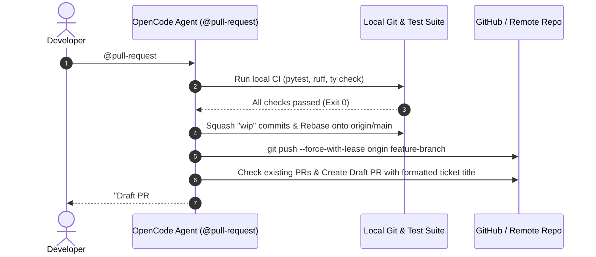

#AICoding #AgentSkills #Skills #WorkflowAutomation #Testing #GitWorkflow #SystemDesign #OpenCode

> [!abstract] Executive Summary
> While basic skills function as reusable prompt templates, **Production Skills** operate as deterministic, executable runbooks. By pairing YAML metadata with sequential checklists, negative guardrails, and file references, production skills transform error-prone manual engineering workflows—such as squashing git branches, drafting pull requests, or generating full-stack regression test suites—into reliable, single-command operations (`@skill_name`).
> 
> This note analyzes two production-grade skill implementations: the **`pull-request` workflow** (governing local CI verification, branch rebasing, and conventional PR formatting) and the **`create-test-program` compiler test generator** (which reads formal specifications in `docs/spec.md`, emits executable examples in `examples/`, and binds them to end-to-end pytest assertions in `tests/test_example_outputs.py`).

---

## 1. Principles of High-Reliability Skill Authoring

When an AI agent executes a complex workflow without a structured runbook, it tends to skip intermediate validation steps—such as running linters before committing or checking if a pull request branch already exists.

```
┌────────────────────────────────────────────────────────────────────────────────────────┐
│                        ANATOMY OF A PRODUCTION-GRADE SKILL                             │
└────────────────────────────────────────────────────────────────────────────────────────┘

    1. Explicit YAML Frontmatter
       • Unique identifier matching directory name.
       • High-signal description guiding router models.

    2. Numbered Step-by-Step Checklist
       • Enforces strict chronological order (e.g. Test -> Stage -> Rebase -> Push).
       • Prevents premature actions (e.g. pushing broken code before running CI).

    3. Unambiguous Formatting Contracts
       • Concrete templates for commit messages, PR titles, and issue linkages.

    4. Hard Negative Guardrails (The "NEVER" Rules)
       • Explicit prohibitions (e.g. "NEVER push direct to main").
```

---

## 2. Production Case Study 1: The `pull-request` Workflow Skill

In modern team environments, opening a Pull Request is not merely running `git push`. It involves verifying local test suites, cleaning up messy intermediate commits, rebasing against upstream `main`, and formatting the pull request description according to team standards.

### The Specification (`.agents/skills/pull-request/SKILL.md`):

```markdown
---
name: pull-request
description: Finalize approved changes into a pull request by adding, committing, rebasing, squashing, and drafting a new pull request
---

## Checklist
1. **Pre-flight Validation:** Run all CI validation steps locally to ensure everything passes. If any check fails, halt immediately and inform the developer.
2. **Atomic Staging & Commit:**
   - Stage and commit the approved changes.
   - If there are any messy "wip", "fixup", or "draft" commits, squash them into the previous most logical commit.
3. **Branch Synchronization:** Rebase the branch onto `origin/main`.
4. **Draft Pull Request Creation:**
   - Check if an open PR already exists for the current branch:
     - If no PR exists, open a new pull request.
     - If a PR already exists, update the existing branch and PR.
   - If the branch history was rewritten locally during rebase/squash, push using `--force-with-lease`.
   - **Title Format:** `[ticket number] - [short description of the change]`
   - **Body Structure:**
     - Include a detailed description using single-sentence bullet points.
     - Link related GitHub issues: `related to #1234` or `resolves #1234`.

## Invariant Rules
- **NEVER** push directly to the `main` branch.
- **NEVER** push code with failing tests or unformatted files.
- Sign off all PR bodies with: `pr drafted by ai slop cannon`.
```



---

## 3. Production Case Study 2: The `create-test-program` Compiler Generator

When engineering compilers, domain-specific languages (DSLs), or interpreters, every language feature must be accompanied by three artifacts:
1. **Specification Alignment:** Conforming to the language grammar defined in `docs/spec.md`.
2. **Reference Example Program:** A runnable `.slop` file in `examples/`.
3. **End-to-End Test Assertion:** A pytest test in `tests/test_example_outputs.py` validating stdout, stderr, and exit codes.

### The Skill Specification (`.agents/skills/create-test-program/SKILL.md`):

```markdown
---
name: create-test-program
description: Generate an example SlopLang program from docs/spec.md and add an exact-output regression test in tests/test_example_outputs.py
---

Given a requested language feature:

1. **Read Specification:**
   - Inspect `docs/spec.md` to identify the syntax rules, operator precedence, and expected output behavior for the feature.

2. **Author Executable Example:**
   - Create a clean, runnable SlopLang source file inside `examples/<feature>.slop`.
   - Ensure the program prints its outputs clearly using `hallucinate(...)✨`.

3. **Bind End-to-End Test:**
   - Add a test function inside `tests/test_example_outputs.py`.
   - Execute the program using Sloperator's runner engine (`sloperator.runner.run_source`).
   - Assert that the output matches the exact expected stdout string, stderr is empty, and the exit code is 0.

4. **Verify Locally:**
   - Run the new test via `uv run pytest tests/test_example_outputs.py -q`.
```

---

## 4. Hands-On Execution: The Equality Feature Case Study

To test the `@create-test-program` skill, the agent is commanded to implement an equality test program:

> *"@create-test-program Create a new `examples/equality.slop` comparing `1 == 1`, `1 == "1"`, and `✅ == 1`, printing each result on its own line."*

### Step 1: Emitted Example File (`examples/equality.slop`)
In SlopLang, `==` evaluates equality. When comparing incompatible types (such as number `1` and string `"1"` or boolean `✅` and number `1`), SlopLang evaluates equality to `❌` (False) rather than throwing a type error:

```sloplang
# examples/equality.slop
hallucinate(1 == 1)✨
hallucinate(1 == "1")✨
hallucinate(✅ == 1)✨
```

### Step 2: Emitted Test in `tests/test_example_outputs.py`
```python
# tests/test_example_outputs.py
import json
from pathlib import Path
import pytest
from sloperator.runner import run_source

def test_equality_example_program_output():
    """Verify examples/equality.slop outputs ✅, ❌, ❌ on individual lines."""
    source_path = Path("examples/equality.slop")
    assert source_path.exists(), "examples/equality.slop must exist"
    
    result = run_source(source_path.read_text())
    
    assert result.exit_code == 0
    assert result.stderr == ""
    assert result.stdout == "✅\n❌\n❌\n"
```

### Step 3: Automated CLI Verification & Test Submission:
```bash
# 1. Verify SKILL.md contains required keywords and paths
cat .agents/skills/create-test-program/SKILL.md | grep "name:"
cat .agents/skills/create-test-program/SKILL.md | grep "description:"
cat .agents/skills/create-test-program/SKILL.md | grep "docs/spec.md"
cat .agents/skills/create-test-program/SKILL.md | grep "examples/"
cat .agents/skills/create-test-program/SKILL.md | grep "tests/test_example_outputs.py"

# 2. Verify examples/equality.slop runs and produces exact expected JSON payload
uv run python -c 'import json; from pathlib import Path; from sloperator.runner import run_source; print(json.dumps(vars(run_source(Path("examples/equality.slop").read_text()))))' | jq '. == {"stdout":"✅\n❌\n❌\n", "stderr":"", "exit_code":0}'
# Expected output: true

# 3. Execute unit test
uv run pytest tests/test_example_outputs.py -q
# Expected exit code: 0

# 4. Submit assignment via Bootdev
bootdev run 25abb859-dfa4-4346-b0b6-60551ab35de6
bootdev run -s 25abb859-dfa4-4346-b0b6-60551ab35de6
```

---

## 5. Architectural Checklist for Production Skills

```
┌────────────────────────────────────────────────────────────────────────────────────────┐
│                        PRODUCTION SKILL AUTHORING CHECKLIST                            │
└────────────────────────────────────────────────────────────────────────────────────────┘

    [ Architecture & Discovery ]
    ✔ Directory name matches the skill identifier (.agents/skills/<name>/).
    ✔ Frontmatter `name` matches directory name.
    ✔ Frontmatter `description` concisely communicates WHAT and WHEN to use the skill.

    [ Execution Design ]
    ✔ Sequential checklist ordered logically (Validate -> Mutate -> Re-verify).
    ✔ Hard non-negotiable negative constraints ("NEVER push to main").
    ✔ Concrete path references to required schemas (docs/spec.md, migrations/).
    ✔ Verification step included in the checklist before completion.
```
