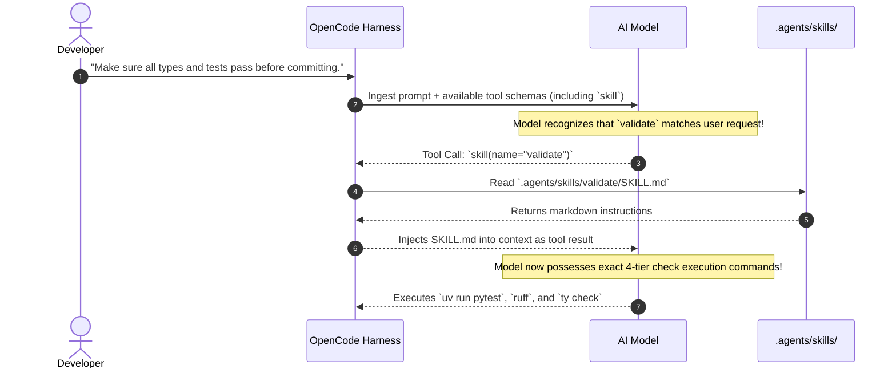
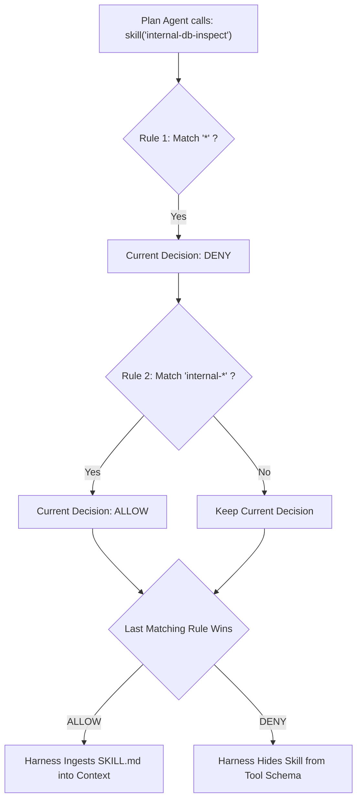

#AICoding #AgentSkills #SkillTool #AccessControl #Permissions #Security #SystemDesign #OpenCode

> [!abstract] Executive Summary
> Skills in modern agent harnesses are not merely static prompt templates invoked manually by developers; they are first-class primitives exposed through the **native `skill` tool**. This enables an autonomous agent to inspect available repository skills, evaluate task requirements, and dynamically inject authoritative Standard Operating Procedures (SOPs) into its active context without human prompting.
> 
> However, autonomous skill execution introduces security and operational risks if an unprivileged agent can access high-impact internal procedures. OpenCode resolves this through **Declarative Skill Access Control** (`action: "skill"` in `opencode.jsonc`), utilizing sequential wildcard matching (`allow`, `ask`, `deny`) and **per-agent permission scoping**. Furthermore, the skill ecosystem is dividing into two durable archetypes: **proprietary team runbooks** coupled to private infrastructure, and **vendor-distributed package skills** shipped by library authors to instruct coding agents on idiomatic modern API usage.

---

## 1. The Native `skill` Tool: How Agents Self-Program Context

In basic usage, developers manually prefix prompts with `@validate` or `@pull-request`. Behind the scenes, however, OpenCode registers a native tool in the agent's API payload:

```jsonc
// OpenCode Harness Native Tool Definition (Sent to LLM)
{
  "name": "skill",
  "description": "Load an authoritative skill workflow into context. Available skills: validate (Run full 4-tier check suite), pull-request (Rebase, squash, and draft PR), create-test-program (Generate compiler tests from spec).",
  "parameters": {
    "type": "object",
    "properties": {
      "name": {
        "type": "string",
        "description": "The exact ID of the skill to load"
      }
    },
    "required": ["name"]
  }
}
```



### The Physics of the Skill Tool:
At its core, the `skill` tool is a **deterministic prompt injector**. Instead of performing fuzzy semantic vector search (RAG), the model invokes the tool to retrieve an exact, human-engineered execution contract. The agent effectively chooses when and how to expand its own context memory.

---

## 2. The Two Real-World Skill Archetypes

Industry hype often anticipates a centralized global marketplace of generic "magic prompts." In production software engineering, however, value concentrates into two concrete categories:

```
┌────────────────────────────────────────────────────────────────────────────────────────┐
│                        THE TWO PRODUCTION SKILL ARCHETYPES                             │
└────────────────────────────────────────────────────────────────────────────────────────┘

    [ Archetype 1: Proprietary Team Runbooks ]
    • Scope: Deeply coupled to internal infrastructure, private databases, and team policies.
    • Examples:
      - `@talk-to-prod-db`: Connects via read-only SSH tunnel to inspect customer billing rows.
      - `@seed-tenant`: Provisions a localized multi-tenant PostgreSQL schema for integration tests.
      - `@release-hotfix`: Runs cherry-pick automation and updates deployment manifest tags.
    • Distribution: Committed directly to the private repository in `.agents/skills/`.

    [ Archetype 2: Vendor / Library Published Skills ]
    • Scope: Shipped by open-source libraries or SaaS SDKs to teach agents idiomatic API usage.
    • Examples:
      - `node_modules/stripe/.agents/skills/checkout/SKILL.md`: Explains how to initialize webhooks
        without using deprecated v2 API calls.
      - `prisma/skills/migrate/SKILL.md`: Explains safe migration generation without dropping tables.
    • Distribution: Distributed via package managers (npm, pip, cargo) alongside library code.
```

---

## 3. Declarative Skill Access Control in `opencode.jsonc`

Just because a skill exists in a repository does not mean every agent should have permission to execute it. An exploratory or planning agent should not trigger automated deployment or database migration skills.

OpenCode governs skill access using the `skill` action in `opencode.jsonc`:

```jsonc
{
  "$schema": "https://opencode.ai/config.json",
  "permissions": [
    // 1. Allow all standard developer skills by default
    {
      "action": "skill",
      "resource": "*",
      "effect": "allow"
    },
    // 2. Lock down sensitive internal infrastructure skills
    {
      "action": "skill",
      "resource": "internal-*",
      "effect": "deny"
    },
    // 3. Require explicit developer confirmation for experimental skills
    {
      "action": "skill",
      "resource": "experimental-*",
      "effect": "ask"
    }
  ]
}
```

### The Three Operational Modes:
- **`allow`:** The skill loads immediately when the agent requests it via tool calling.
- **`ask`:** The harness pauses execution, displaying an interactive approval prompt to the developer before loading the skill into context.
- **`deny`:** The skill is completely hidden from the agent. It is stripped from the tool schema, making the agent unaware that the skill even exists.

---

## 4. Sequential Evaluation & Per-Agent Scoping

Skill permissions follow OpenCode's universal rule: **rules are evaluated in sequential order, and the last matching rule wins**.

Furthermore, skill permissions can be scoped to specific agent personas (such as OpenCode's built-in `plan` agent or a custom reviewer):

```jsonc
{
  "$schema": "https://opencode.ai/config.json",
  "agents": {
    "plan": {
      "mode": "primary",
      "description": "Read-only architectural planning agent",
      "permissions": [
        // Step 1: Deny access to ALL skills by default for the planning agent
        {
          "action": "skill",
          "resource": "*",
          "effect": "deny"
        },
        // Step 2: Override deny for internal diagnostic skills (Last matching rule wins!)
        {
          "action": "skill",
          "resource": "internal-*",
          "effect": "allow"
        }
      ]
    }
  }
}
```



---

## 5. Defense-in-Depth: Skill Permissions vs. Tool Permissions

A vital security distinction in agentic architecture is the separation between **Skill Gating** and **Tool Execution Gating**:

```
┌────────────────────────────────────────────────────────────────────────────────────────┐
│                        DUAL-LAYER DEFENSE: SKILLS vs. EXECUTION TOOLS                  │
└────────────────────────────────────────────────────────────────────────────────────────┘

    [ Layer 1: Skill Permission (Prompt Loading Gate) ]
    • Action: `action: "skill"`
    • Governs: Can the agent READ and INGEST the skill instructions?
    • If DENIED: The agent cannot read the instructions.

    [ Layer 2: Tool Permission (Execution Gate) ]
    • Action: `action: "shell"`, `action: "edit"`, `action: "webfetch"`
    • Governs: Can the agent actually EXECUTE the commands listed in the skill?
    • If DENIED: Even if the skill is loaded, the underlying command is blocked!
```

> [!SECURITY] Defense-in-Depth Invariant
> Loading a skill does **not** bypass tool permissions. If a loaded skill instructs an agent to execute `shell("rm -rf /")`, but `opencode.jsonc` has `{ "action": "shell", "resource": "*", "effect": "ask" }`, the harness will still halt and demand human approval before executing the shell command.

---

## 6. Access Control Decision Matrix

| Skill Category | Naming Pattern | Recommended Effect | Rationale |
| :--- | :--- | :--- | :--- |
| **Standard Quality Checks** | `validate`, `lint`, `format` | `allow` | Safe, non-destructive read/verification operations; zero friction. |
| **Repository Scaffolding** | `create-test-program`, `new-endpoint` | `allow` | Local file generation; safe under version control. |
| **Experimental Features** | `experimental-*`, `beta-*` | `ask` | Prevents agents from running unverified prototype workflows silently. |
| **Production Mutations** | `deploy-*`, `db-migrate-*` | `ask` or `deny` | High blast-radius operations; requires mandatory human eyes on diffs. |
| **Read-Only Personas (Plan)** | `*` denied, `diag-*` allowed | Per-agent scoped | Constrains planning agents to analysis without loading mutation scripts. |
