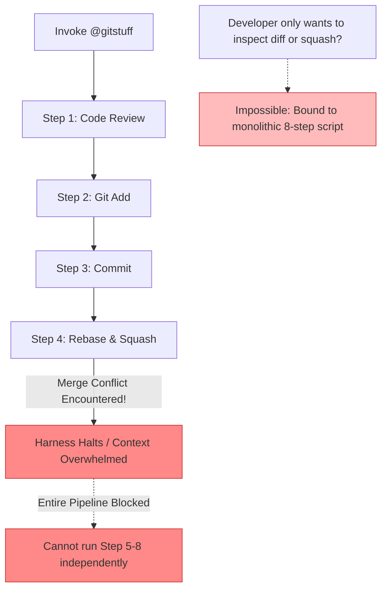
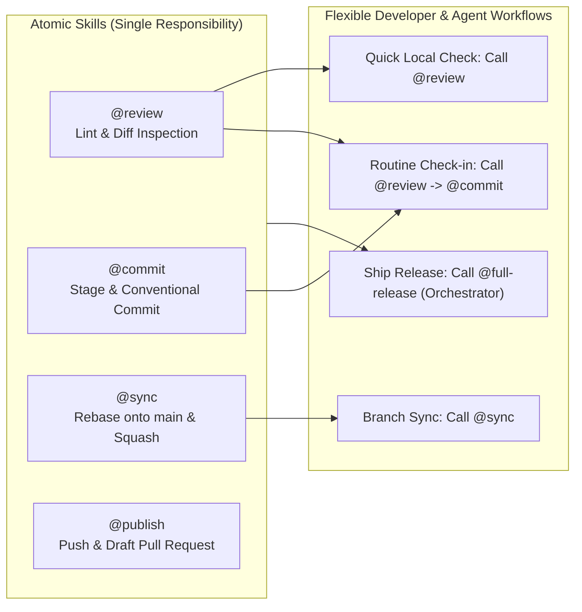
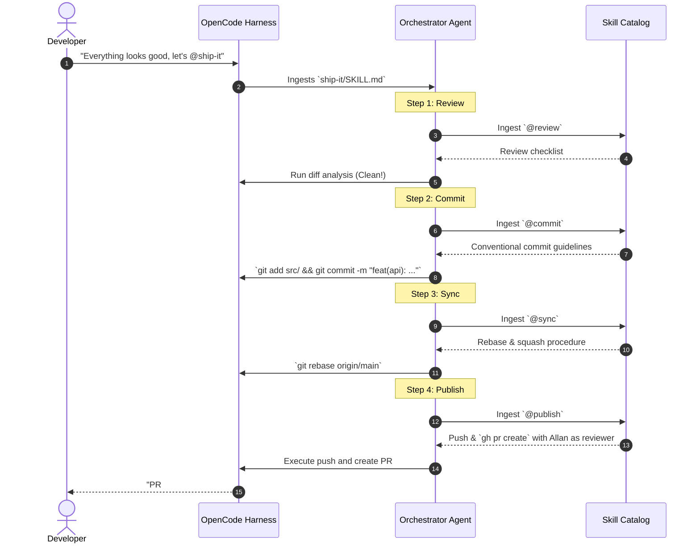

#AICoding #AgentSkills #ComposableArchitecture #UnixPhilosophy #ExtensionTaxonomy #ToolsVsSkillsVsAgents #SystemDesign #OpenCode

> [!abstract] Executive Summary
> As agentic workflows expand from ad-hoc prompting into production software engineering, agents require a structured extension model. Two fundamental design principles govern sustainable agent architectures:
> 
> 1. **Composable Skill Design (The Unix Philosophy):** Monolithic "god-mode" skills (`cracked-engineer-god-mode`, monolithic `gitstuff`) fail due to rigid execution sequences, token context bloat, and fragile error recovery. Decomposing workflows into modular, single-responsibility skills (`review`, `commit`, `sync`, `publish`) allows surgical developer invocation, autonomous agent composition, and hierarchical orchestration without duplicating instructions.
> 2. **The Extensibility Taxonomy (Tool vs. Skill vs. Agent):** When automating workflows, developers frequently conflate tools, skills, and agents because all three appear as functional capabilities. In reality, they form an escalating hierarchy:
>    - **Tool (Smallest / Deterministic):** Custom execution code with typed JSON inputs/outputs (e.g., database clients, AST parsers).
>    - **Skill (Middle / Procedural):** Reusable markdown SOP prompt templates and bundled disk assets loaded on-demand (e.g., PR checklists, test generation recipes).
>    - **Agent (Largest / Architectural):** An isolated persona and execution mode with dedicated model selection, system prompt, permission boundaries, and step budgets (e.g., read-only planner, security auditor).

---

## 1. The Anti-Pattern: Monolithic Mega-Skills

When teams first encounter agent skills, the initial temptation is to encapsulate an entire multi-stage engineering lifecycle into a single monolithic skill file:

```
┌─────────────────────────────────────────────────────────────────────────────────────────┐
│                        ANTI-PATTERN: THE "GOD-MODE" MEGA-SKILL                          │
└─────────────────────────────────────────────────────────────────────────────────────────┘

  .agents/skills/gitstuff/SKILL.md (or 'cracked-engineer-god-mode')
  ├── Step 1: Review working directory diff for bugs and style issues.
  ├── Step 2: Stage modified files if validation passes.
  ├── Step 3: Write conventional commit message (max 1 sentence).
  ├── Step 4: Rebase onto main, resolve merge conflicts, and squash commits into one.
  ├── Step 5: Push branch to origin as 'username_three_word_description'.
  ├── Step 6: Create draft Pull Request with bulleted changelog and issue links.
  ├── Step 7: Append signoff footer: "pr drafted by ai slop cannon".
  └── Step 8: Assign code review to Allan.
```

### Critical Failure Vectors of Monolithic Skills



1. **Zero Granular Reusability:** If a developer only needs to inspect their working directory changes for issues without staging or committing, they cannot call `@gitstuff`. If they already committed changes and just need to rebase and open a PR, the monolithic skill forces unnecessary or conflicting re-execution of steps 1–3.
2. **Context Window Exhaustion:** Loading an 8-stage instruction set with instructions for diff inspection, Git squashing algorithms, conventional commit lint rules, and GitHub CLI PR syntax burns valuable attention tokens before the agent even writes code.
3. **Fragile Cascading Failures:** If step 4 encounters an upstream rebase conflict, the agent's context is simultaneously cluttered with PR drafting instructions and review assignments. The model loses focus on the active conflict resolution task.

---

## 2. Composable Skill Architecture & The Unix Philosophy

The Unix philosophy articulates three timeless engineering tenets:
> 1. Make each program do one thing well.
> 2. To do a new job, build afresh rather than complicate old programs by adding new "features".
> 3. Expect the output of every program to become the input to another, as yet unknown, program.

Applied to agent skill design, monolithic pipelines are decomposed into **atomic, single-purpose skills**:

```
┌─────────────────────────────────────────────────────────────────────────────────────────┐
│                    ATOMIC DECOMPOSITION: THE UNIX SKILL SUITE                           │
└─────────────────────────────────────────────────────────────────────────────────────────┘

  .agents/skills/
  ├── review/
  │   └── SKILL.md  --> Inspects working directory, lints diffs, flags regressions.
  ├── commit/
  │   └── SKILL.md  --> Stages verified files, writes conventional commit (<= 1 sentence).
  ├── sync/
  │   └── SKILL.md  --> Rebases current branch onto main, squashes commits to single SHA.
  └── publish/
      └── SKILL.md  --> Pushes feature branch, opens PR with summary & reviewer assignment.
```



### Deconstructed Production Skill Definitions

#### Skill 1: `review` (`.agents/skills/review/SKILL.md`)
```markdown
---
name: review
description: Inspects working directory changes for style regressions, debug artifacts, and type safety.
---

# Code Review Procedure

1. Run `git status -s` and `git diff` against `HEAD`.
2. Inspect changes against the following quality gates:
   - No leftover debug logging (`console.log`, `print`, `dbg!`, `debugger`).
   - No committed secrets, API keys, or `.env` files.
   - Code adheres strictly to repository architectural boundaries.
3. If issues are identified, output a Markdown table of file paths and specific line violations.
4. Do NOT stage or commit files. Halt execution for developer remediation.
```

#### Skill 2: `commit` (`.agents/skills/commit/SKILL.md`)
```markdown
---
name: commit
description: Stages verified modifications and creates a strictly formatted conventional commit.
---

# Conventional Commit Procedure

1. Verify that the working directory passes all linters and type checkers.
2. Stage modified files using `git add <explicit-file-paths>`. Never run `git add .` indiscriminately.
3. Generate a commit message following the Conventional Commits specification:
   - Format: `<type>(<scope>): <imperative sentence>`
   - Length constraint: Strictly **one sentence**, maximum 72 characters.
   - Example: `fix(auth): invalidate refresh token on explicit user logout`
4. Execute `git commit -m "<message>"`.
```

#### Skill 3: `sync` (`.agents/skills/sync/SKILL.md`)
```markdown
---
name: sync
description: Rebases current feature branch onto upstream main and squashes commits.
---

# Branch Synchronization & Squashing Procedure

1. Verify that working directory is completely clean (`git status`).
2. Fetch latest changes from remote: `git fetch origin main`.
3. Rebase the current branch onto `origin/main`: `git rebase origin/main`.
4. If conflicts occur, pause, display conflicted files, and request guidance.
5. Once rebased, squash all branch commits into a single cohesive commit atop `origin/main`.
```

#### Skill 4: `publish` (`.agents/skills/publish/SKILL.md`)
```markdown
---
name: publish
description: Pushes feature branch to remote origin and generates a structured GitHub pull request.
---

# Branch Publication & Pull Request Procedure

1. Determine current feature branch name. Ensure it adheres to `developer/three-word-description`.
2. Push branch to remote: `git push -u origin HEAD`.
3. Generate pull request using GitHub CLI (`gh pr create`):
   - Title: Match the squashed commit message.
   - Body:
     - High-level architectural summary.
     - Bulleted list of key behavioral changes.
     - Reference related issue IDs (`Fixes #123`).
     - Footer: `*PR drafted by AI slop cannon*`.
4. Request review from project maintainer: `gh pr edit --add-reviewer Allan`.
```

---

## 3. High-Level Orchestrator Skills: Composition without Duplication

How do we retain the convenience of an automated end-to-end pipeline without maintaining a duplicated, monolithic script?

**Answer:** Create a **Composite Orchestration Skill** that references atomic skills sequentially.

```
┌─────────────────────────────────────────────────────────────────────────────────────────┐
│                      COMPOSITE ORCHESTRATOR SKILL (.agents/skills/ship-it/SKILL.md)     │
└─────────────────────────────────────────────────────────────────────────────────────────┘

  ---
  name: ship-it
  description: End-to-end delivery workflow; chains review, commit, sync, and publish skills.
  ---

  # Ship-It Orchestration Procedure

  Execute the following discrete engineering skills in sequential order:

  1. Load and execute the `@review` skill.
     - If code violations or unformatted files are found, HALT immediately.
  2. Load and execute the `@commit` skill to stage and commit the verified changes.
  3. Load and execute the `@sync` skill to rebase onto upstream main and squash commits.
  4. Load and execute the `@publish` skill to push the branch, draft the PR, and assign Allan.
```



### Why Composition Wins in Production:
- **Zero Instruction Duplication:** Changes to the commit message format only occur in `commit/SKILL.md`. Both direct `@commit` calls and `@ship-it` orchestrations inherit the change immediately.
- **Fail-Fast Boundaries:** If `@review` fails, the agent never loads `@publish` or `@sync` into context. The context window remains clean, dedicated solely to debugging the specific review failure.
- **Adaptive Execution:** A senior engineer can run `@commit` locally, resolve an tricky rebase manually, and then invoke `@publish` directly, bypassing the prior pipeline stages.

---

## 4. The Extensibility Taxonomy: Tool vs. Skill vs. Agent

A persistent source of architectural confusion in modern agent frameworks (OpenCode, Claude Code, Cursor, Windsurf) is determining whether a required capability should be implemented as a **Tool**, a **Skill**, or an **Agent**.

Because all three constructs extend agent capability, developers often build bloated tools where simple skills suffice, or create fragile prompts where custom code is required.

```
┌─────────────────────────────────────────────────────────────────────────────────────────┐
│                       THE AGENT EXTENSIBILITY SPECTRUM                                  │
│                                                                                         │
│     [ TOOLS ]                   [ SKILLS ]                   [ AGENTS ]                 │
│   Deterministic Code        Procedural Knowledge         Systemic Personas              │
│  (Custom Code + Schema)     (Markdown SOP + Assets)   (Model + Rules + Permissions)     │
│                                                                                         │
│  ◀── Smaller, Code-Heavy ──────────────────────────────── Larger, Policy-Heavy ──▶      │
└─────────────────────────────────────────────────────────────────────────────────────────┘
```

### The Three Primitives Defined

#### 1. Tool (Deterministic Execution Primitive)
- **What it is:** Custom executable code (written in TypeScript, Python, Go, or rust) exposing a strictly typed JSON Schema parameter interface to the LLM.
- **When to use:** When the task requires deterministic computation, external system integration, binary parsing, or cryptographic guarantees where LLM hallucination is unacceptable.
- **Characteristics:**
  - Defined inputs (`parameters` object) and structured return values.
  - LLMs cannot inspect the tool's internal source code; they only see the schema and docstring.
  - Examples: `sql_query(query: string)`, `ast_grep(pattern: string)`, `send_slack_alert(channel: string, msg: string)`.

#### 2. Skill (Procedural Knowledge Primitive)
- **What it is:** A reusable Markdown file (`SKILL.md`) containing Standard Operating Procedures (SOPs), decision trees, domain checklists, and optional bundled scripts or test assets.
- **When to use:** When the agent already possesses the required tools (e.g., `read_file`, `shell`, `edit`), but needs authoritative guidance on **how**, **when**, and **in what sequence** to use them for project-specific tasks.
- **Characteristics:**
  - Injected directly into LLM working context on-demand.
  - Highly flexible, non-deterministic reasoning guidance.
  - Zero token cost when not in use; loaded via native `skill` tool or `@` mention.
  - Examples: `@validate`, `@pull-request`, `@talk-to-database`, `@generate-test-fixtures`.

#### 3. Agent (Operational Persona Primitive)
- **What it is:** A self-contained operational mode configured with a dedicated model tier, isolated context memory, customized system prompt, step/recursion limits, and fine-grained tool/skill permission rules.
- **When to use:** When a workflow requires a distinct level of autonomy, security isolation, or specialized cognitive behavior that should not contaminate the primary conversational session.
- **Characteristics:**
  - Complete context isolation (subagent thread or distinct mode).
  - Can be restricted to read-only tools (e.g., planning agent) or granted elevated autonomous tool execution.
  - Configurable model choice (e.g., lightweight/fast model for review vs. flagship model for deep architecture).
  - Examples: `plan` (read-only architectural strategist), `sec-audit` (penetration tester), `tdd-worker` (unattended test-driven implementer).

---

## 5. Architectural Decision Matrix

```
┌─────────────────────────────────────────────────────────────────────────────────────────┐
│                          DECISION HEURISTIC: WHAT TO BUILD?                             │
└─────────────────────────────────────────────────────────────────────────────────────────┘

                                 [ Need Automation ]
                                          │
                  Does it require custom code, deterministic logic,
                  or API integrations that shell/tools can't do?
                                   /             \
                             YES  /               \  NO
                                 ▼                 ▼
                           ┌──────────┐     Does it require a distinct model,
                           │  TOOL    │     isolated context, or special
                           └──────────┘     security/permission boundaries?
                                                      /             \
                                                YES  /               \  NO
                                                    ▼                 ▼
                                              ┌──────────┐      ┌──────────┐
                                              │  AGENT   │      │  SKILL   │
                                              └──────────┘      └──────────┘
```

| Dimension | Tool | Skill | Agent |
| :--- | :--- | :--- | :--- |
| **Primary Artifact** | TypeScript / Python code + JSON Schema | Markdown file (`SKILL.md`) + local assets | JSONC / YAML config (`opencode.jsonc`) |
| **Execution Substrate** | Local process / RPC / MCP Server | LLM Context Window (Prompt Injection) | Harness Subagent Loop / Dedicated Session |
| **Reasoning vs Code** | 100% Code / Deterministic | 90% Natural Language Reasoning / 10% Helper scripts | Full LLM Session + Orchestration Meta-Rules |
| **Context Overhead** | Minimal (Tool Schema in system prompt: $\sim 50\text{--}150$ tokens) | Zero until invoked; $\sim 300\text{--}2,000$ tokens when active | Dedicated independent context window |
| **Permission Boundary** | Sandboxed per tool (`allow`/`ask`/`deny`) | Inherits current agent's permissions | Declares its own root permission policy |
| **Model Selection** | Inherits calling agent's active model | Inherits calling agent's active model | Explicitly configurable (e.g., Claude 3.5 Haiku vs Sonnet) |
| **Typical Failure Mode** | Unhandled runtime exception / exit code $\neq 0$ | Hallucination or skipped checklist steps | Runaway recursive loops / subagent exhaustion |

---

## 6. Concrete Case Study: Database Migration Workflow

To observe how Tools, Skills, and Agents collaborate without architectural overlap, consider an enterprise database schema migration workflow:

```
┌─────────────────────────────────────────────────────────────────────────────────────────┐
│              COLLABORATIVE ARCHITECTURE: TOOL + SKILL + AGENT IN HARMONY                │
└─────────────────────────────────────────────────────────────────────────────────────────┘

  1. THE AGENT: "db-admin"
     ├── Model: Claude 3.5 Sonnet (high reasoning capacity)
     ├── Permissions:
     │   ├── tool "db-query": allow
     │   ├── tool "shell": ask (requires explicit developer confirmation for mutations)
     │   └── tool "webfetch": deny
     └── Context: Isolated from main feature-coding context.

  2. THE SKILL: "zero-downtime-migration" (.agents/skills/zero-downtime-migration/SKILL.md)
     ├── Procedural SOP:
     │   - Step 1: Add new column as nullable.
     │   - Step 2: Backfill data in micro-batches using `@db-query`.
     │   - Step 3: Add application dual-write layer.
     │   - Step 4: Add NOT NULL constraint only after 100% backfill verified.
     └── Checklists: Postgres lock timeout configurations (`SET lock_timeout = '2s'`).

  3. THE TOOL: "db-query" (Node.js / TypeScript MCP Tool)
     ├── Code: Connects to local or staging PostgreSQL container via connection pool.
     ├── Parameters: `{ "sql": string, "transaction": boolean }`
     └── Guarantees: Automatic query cancellation on timeout; read-only fallback mode.
```

```mermaid
sequenceDiagram
    autonumber
    actor Dev as Developer
    participant Harness as OpenCode Harness
    participant Agent as Agent: db-admin (Isolated Session)
    participant Skill as Skill: zero-downtime-migration
    participant Tool as Tool: db-query (TypeScript MCP)
    participant DB as Postgres Engine

    Dev->>Harness: Delegate migration task to `db-admin` agent
    Harness->>Agent: Boots isolated session with restricted permissions
    Agent->>Skill: Loads `@zero-downtime-migration`
    Skill-->>Agent: Injects dual-write & lock-timeout SOP
    
    Note over Agent: Agent follows Skill SOP strictly!
    Agent->>Tool: Invoke `db-query(sql="ALTER TABLE users ADD COLUMN phone VARCHAR(20);")`
    Tool->>DB: Executes parameterized SQL
    DB-->>Tool: Query OK (4ms)
    Tool-->>Agent: Result: Success
    
    Agent->>Tool: Invoke `db-query(sql="SET lock_timeout = '2s'; ...")`
    Tool->>DB: Executes lock timeout
    DB-->>Tool: OK
    Tool-->>Agent: Invariant confirmed
    
    Agent-->>Dev: "Migration completed safely according to zero-downtime SOP."
```

### Key Takeaway for Architects:
- If you tried to make the **Tool** do the migration reasoning, your TypeScript code would be tens of thousands of lines of fragile heuristic edge cases.
- If you tried to make the **Skill** execute raw network sockets to Postgres, the LLM would fail because Markdown cannot open TCP streams.
- If you ran this in the **Main Agent** without an isolated **Persona**, the hundreds of rows of SQL schema output would pollute your feature-development context.

The synthesis of **atomic tools**, **composable skills**, and **sandboxed agents** forms the foundation of reliable agentic software engineering.
