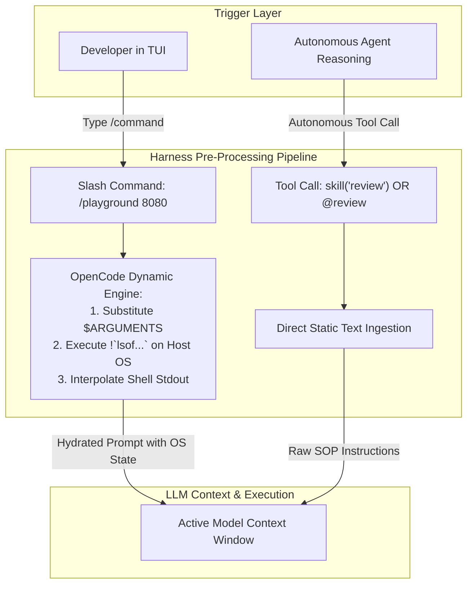
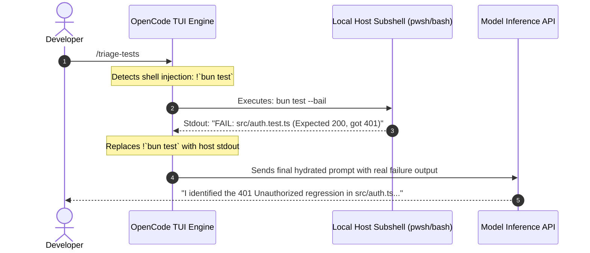
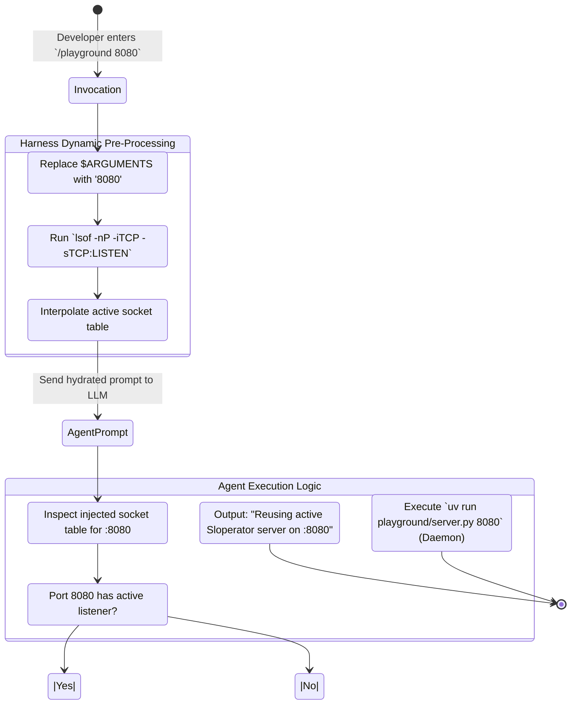

#AICoding #CustomCommands #DynamicPrompting #ShellInjection #OpenCode #SkillsVsCommands #DevOps #SystemDesign

> [!abstract] Executive Summary
> Modern agent harnesses provide two distinct prompt-templating paradigms that appear outwardly identical but serve fundamentally divergent architectural roles: **Agent Skills** (`.agents/skills/` or `.opencode/skills/`) and **Custom Commands** (`.opencode/commands/`).
> 
> - **Skills** are autonomous agent capabilities exposed through the native `skill` tool. The LLM proactively inspects available skills and dynamically self-injects Standard Operating Procedures (SOPs) into its context when semantically relevant.
> - **Commands** are user-initiated Terminal UI (TUI) shortcuts prefixed with a forward slash (`/command-name`). They are designed for manual developer execution, bypassing the LLM tool catalog entirely.
> 
> Critically, OpenCode equips Custom Commands with a **Dynamic Prompt Pre-Processing Engine**. Before a prompt is transmitted to the inference model, the harness evaluates **positional command arguments** (`$1`, `$2`, `$ARGUMENTS`) and executes local **shell output injection blocks** (`!command\``). This empowers developers to inject deterministic, real-time operating system state (such as active TCP port listeners via `lsof` or test runner outcomes) directly into the agent's prompt text without incurring tool-calling roundtrips or risking model hallucination.

---

## 1. Architectural Distinction: Skills vs. Commands

Both Skills and Commands are defined as Markdown files containing reusable prompt instructions. Both can be declared at the **project level** (`.opencode/commands/` or `.agents/skills/`) or at the **global developer level** (`~/.config/opencode/commands/` or `~/.config/opencode/skills/`).

However, their runtime discovery, invocation mechanics, and execution pipelines are completely segregated:

```
┌─────────────────────────────────────────────────────────────────────────────────────────┐
│                     THE INVOCATION & DISCOVERY SUBSTRATE DICHOTOMY                      │
└─────────────────────────────────────────────────────────────────────────────────────────┘

     [ AGENT SKILLS ]                                   [ CUSTOM COMMANDS ]
     • Trigger: Agent Autonomous Choice OR @mention     • Trigger: Human Developer Slash Shortcut
     • Interface: Native `skill` Tool Schema            • Interface: Interactive TUI Slash Command (`/`)
     • Discovery: Exposed in System Tool Catalog        • Discovery: Hidden from LLM Tool Catalog
     • Pre-processing: Static text injection            • Pre-processing: Dynamic Shell & Argument Engine
     • Purpose: Agent Standard Operating Procedures     • Purpose: Fast, Parameterized Developer Shortcuts
```



### The Architectural Rule of Thumb:
- **Choose a Skill** if the capability is a reusable procedure that the **agent** should proactively discover, evaluate, and invoke autonomously when solving complex tasks.
- **Choose a Command** if the capability is an ergonomic, parameterized shortcut that **you (the human developer)** want to trigger manually from the keyboard to steer the agent.

---

## 2. Dynamic Prompting: Positional Arguments & Shell Injection

The OpenCode command processor features a pre-execution compilation step that parses and hydrates Markdown templates before passing them to the agent's inference stream.

### 2.1 Positional & Aggregate Argument Interpolation

Command templates support dynamic parameter substitution using Unix-style shell variables:
- `$ARGUMENTS` (or `$*`): Evaluates to the entire string passed after the command name.
- `$1`, `$2`, `$3`...: Evaluates to whitespace-delimited positional tokens.

#### Example: Positional Tokenization (`.opencode/commands/linusfunc.md`)
```markdown
---
description: Builds a function with uncompromising standards like Linus Torvalds
---

Write a new function, complete with tests the way Linus Torvalds would.
The function is $1.
It should $2 include unit tests.
Ensure the algorithmic complexity is strictly O(1) with zero allocations.
```

When invoked by the developer in the chat terminal:
```bash
/linusfunc ring_buffer definitely
```

The harness interpolates `$1 = "ring_buffer"` and `$2 = "definitely"`, dispatching the rendered text directly to the model:
```markdown
Write a new function, complete with tests the way Linus Torvalds would.
The function is ring_buffer.
It should definitely include unit tests.
Ensure the algorithmic complexity is strictly O(1) with zero allocations.
```

If `$ARGUMENTS` is used instead:
```markdown
---
description: Linus Torvalds style implementer
---

Write a new function, complete with tests like Linus Torvalds would:
$ARGUMENTS
```
Invocation:
```bash
/linusfunc a cache-line aligned lockless queue for telemetry events
```
The entire string following `/linusfunc` replaces `$ARGUMENTS`.

---

### 2.2 Shell Output Pre-Execution Injection (`!command\``)

The most potent feature of Custom Commands is **pre-execution shell injection**. By prefixing backtick-enclosed commands with an exclamation point (`!`), OpenCode executes the shell command on the host OS **before** rendering the prompt:

$$\text{User Input} \xrightarrow{\quad} \text{TUI Parser} \xrightarrow{\quad} \text{Host Subshell Exec } (!\dots) \xrightarrow{\quad} \text{Interpolate Stdout} \xrightarrow{\quad} \text{LLM API Request}$$

```markdown
---
description: Fast test suite triage
---

Here are the current test suite failures from the local test runner:
!`bun test --bail 2>&1`

Analyze the failing assertions above, read the relevant source files, and fix the bugs.
```



### Why Pre-Execution Shell Injection is Architecturally Superior:
1. **Zero Tool-Calling Latency:** The model does not need to emit a `shell` tool call, wait for the harness to prompt the developer for permissions, execute the command, and process a second API roundtrip. The telemetry is present on token 0.
2. **Absolute Ground Truth:** The model is not hallucinating or guessing what might have failed; it receives raw, unfiltered compiler or system output.
3. **Deterministic Snapshotting:** By capturing ephemeral state (such as active network ports or transient crash logs) at the exact millisecond of invocation, the agent operates on an accurate system snapshot.

> [!WARNING] Dynamic Shell Injection Is Exclusive to Commands
> Dynamic argument replacement (`$ARGUMENTS`, `$1`) and shell injection (`!command\``) **only** execute within Custom Commands (`.opencode/commands/`).
> 
> If you invoke a skill using `@skill-id` or via the native `skill` tool, dynamic command parsing is **not** performed; the skill markdown is ingested as literal text.

---

### 2.3 The File Reference Caveat: `@` Ingestion vs. Prose Instructions

In OpenCode's interactive prompt input box, typing `@path/to/file` opens a fuzzy file picker and dynamically attaches the file's contents into the context payload.

However, inside a command template file (`.opencode/commands/<name>.md`), the `@path/to/file` syntax **does not expand**—it remains literal text.

```markdown
<!-- INCORRECT: Will NOT expand in a custom command template -->
Refactor @src/server.py to use async/await.

<!-- CORRECT: Instruct the agent in plain imperative prose -->
Read `src/server.py`, then refactor its network handlers to use async/await.
```

When instructed via prose, the agent uses its native `read_file` tool during turn 1 to inspect the target file cleanly and reliably.

---

## 3. Production Case Study: The Playground Server Daemon

To master command authoring, argument defaults, and shell injection, consider building a custom `/playground` command.

### 3.1 The Engineering Challenge
The development team frequently uses a local interactive REPL and documentation server (`playground/server.py`). However, developers repeatedly encounter port collisions (`EADDRINUSE`) because background servers are left running or multiple sessions spawn duplicate daemons.

We must construct a command that:
1. Accepts an optional port argument, defaulting to `8080`.
2. Inspects current TCP listeners on the host machine prior to prompt submission.
3. Keeps the port argument outside the shell-injection block so the shell command does not depend on dynamic parsing.
4. Instructs the agent to check the injected listener list, verify if an existing Sloperator server is running on the target port, reuse it if present, or spawn `uv run playground/server.py <port>` as a background daemon if absent.

---

### 3.2 Command Specification: `.opencode/commands/playground.md`

```markdown
---
description: Start or reuse the Sloperator Playground HTTP server daemon on a target port
---

You are managing the local Sloperator Playground development server.

Target Port: $ARGUMENTS
(If the target port above is empty or whitespace, default to 8080).

Here is the current list of listening TCP sockets on this machine:
!`lsof -nP -iTCP -sTCP:LISTEN`

### Operational Instructions:
1. Determine the target port from the Target Port field above (use 8080 if not specified).
2. Inspect the pre-injected listener list above to verify whether a server is already actively listening on the target port.
3. If an existing server or Sloperator daemon is already listening on the target port:
   - Do NOT attempt to spawn a duplicate process.
   - Confirm that the running server is healthy and report to the user that the existing playground server on http://localhost:<port> is being reused.
4. If no server is listening on the target port:
   - Launch the server in the background using the command: `uv run playground/server.py <port>`
   - Verify the daemon successfully bound to the port and report that the playground is now live at http://localhost:<port>.
```



### 3.3 Dissecting the Implementation Details:

1. **Clean Syntax Separation:**
   - Notice that `!`lsof -nP -iTCP -sTCP:LISTEN`` contains zero shell interpolation variables. The port parameter `$ARGUMENTS` is kept outside the backtick injection block. This prevents shell escaping bugs, command injection vulnerabilities, and cross-platform subshell quoting failures.
2. **Deterministic Process Check:**
   - Because `lsof` executes immediately upon slash-command invocation, the LLM receives the real-time socket table without running a preliminary shell query tool call.
3. **Idempotent Daemon Lifecycle:**
   - When the user runs `/playground 8080` the first time, the socket list does not contain `:8080`. The agent starts the background daemon.
   - When the user runs `/playground 8080` a second time, the injected `lsof` table contains `python3 ... :8080 (LISTEN)`. The agent immediately identifies the listener, halts startup, and reuses the active instance.

---

## 4. Verification & Testing: Boot.dev CLI Validation

When evaluating command implementations with automated verification harnesses (e.g., Boot.dev CLI checks), the evaluation runner verifies both structural template integrity and operational HTTP health:

```bash
# Execute local test verification
bootdev run e5332d14-9010-4345-82b3-5b660b9164dd

# Submit graded solution
bootdev run -s e5332d14-9010-4345-82b3-5b660b9164dd
```

### Automated Assertion Pipeline:
```
┌─────────────────────────────────────────────────────────────────────────────────────────┐
│                           AUTOMATED VERIFICATION PIPELINE                               │
└─────────────────────────────────────────────────────────────────────────────────────────┘

  [ Test Suite 1: Command Template Structural Integrity ]
  $ cat .opencode/commands/playground.md
  ✔ Exit Code: 0
  ✔ stdout contains '$ARGUMENTS'
  ✔ stdout contains '8080'
  ✔ stdout contains '!`lsof'
  ✔ stdout contains 'playground/server.py'

  [ Test Suite 2: HTTP Endpoint Health & Daemon Smoke Test ]
  $ curl -i http://localhost:8080/
  ✔ HTTP/1.1 200 OK
  ✔ Content-Type: text/html; charset=utf-8
  ✔ Response Body contains: 'SlopLang Playground'
```

---

## 5. The Unified Extensibility Taxonomy: The Complete 6-Primitive Matrix

With the addition of Custom Commands, we can now assemble the comprehensive architectural taxonomy of agent extension points:

```
┌─────────────────────────────────────────────────────────────────────────────────────────┐
│                    THE COMPLETE AGENTIC ARCHITECTURAL TAXONOMY                          │
│                                                                                         │
│  [PROMPT]    [RULES]       [COMMANDS]        [SKILLS]        [TOOLS]        [AGENTS]    │
│  Ephemera    Global Laws   Human TUI        Autonomous SOPs  Deterministic  Isolated    │
│  (Chat Box)  (AGENTS.md)   (/slash-cmd)     (@mention/tool)  Exec (Code)    Personas    │
└─────────────────────────────────────────────────────────────────────────────────────────┘
```

| Primitive | Primary Trigger | Where It Lives | Dynamic Ingestion | Primary Use Case |
| :--- | :--- | :--- | :--- | :--- |
| **Interactive Prompt** | Human typing | Ephemeral chat UI | Yes (`@file`, `!cmd` in box) | One-off steering, conversational queries, local instructions. |
| **Repository Rules** | Every session boot | `AGENTS.md` (root / hierarchical) | No (Static prompt injection) | Non-negotiable repo invariants, code style, linter mandates. |
| **Custom Commands** | Human slash prefix (`/`) | `.opencode/commands/<name>.md` | **Yes (`$ARGUMENTS`, `!cmd\`)** | Parameterized developer shortcuts, pre-execution host checks. |
| **Agent Skills** | Agent autonomous tool call OR `@name` | `.agents/skills/<name>/SKILL.md` | No (Static prompt injection) | Reusable domain runbooks, multi-step checklists, team SOPs. |
| **Custom Tools** | Agent autonomous tool call | TypeScript / Python plugin via MCP | No (Deterministic code execution) | Database queries, AST analysis, external network APIs. |
| **Subagents** | Harness delegation OR user mode | `opencode.jsonc` or `.agents/` | Independent session context | Isolated personas, read-only planning, security auditing. |

### Summary Architecture Guidelines:
1. Never put operational shortcuts in `AGENTS.md`—rules cost tokens in every session.
2. Never make a skill when you need pre-execution host shell commands or dynamic argument parsing—use a **Custom Command**.
3. Never make a custom command for procedures the agent should autonomously discover and invoke on its own—use an **Agent Skill**.
4. Never implement complex business logic or external API network drivers inside a prompt—write a deterministic **Tool**.
